# The Transformer, Piece by Piece

## Contents
{: .no_toc}

* TOC
{:toc}

## 1. Where It Started: Recurrent Neural Networks

Before 2017, sequence tasks such as machine translation were dominated by recurrent neural networks (RNNs, LSTMs, GRUs). An RNN reads a sentence one token at a time and carries a **hidden state** forward, a running summary of everything it has read so far.

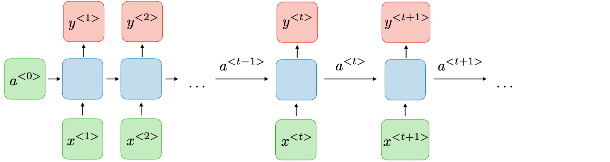
Image source: [Stanford CS 230 Recurrent Neural Networks cheatsheet](https://stanford.edu/~shervine/teaching/cs-230/cheatsheet-recurrent-neural-networks) by Afshine and Shervine Amidi

The figure "unrolls" the network over time. Each blue box is the same cell: it takes the current token $x^{\langle t \rangle}$ and the previous hidden state $a^{\langle t-1 \rangle}$, and produces a new hidden state $a^{\langle t \rangle}$ plus an optional output $y^{\langle t \rangle}$. (The figures call the hidden state $a$; I will write $h$ from here on.) Inside a box:

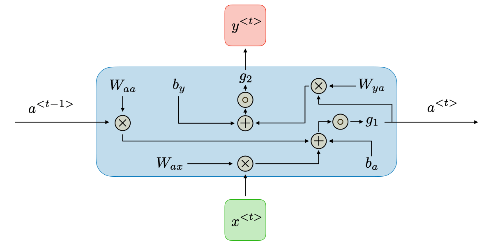
Image source: [Stanford CS 230 Recurrent Neural Networks cheatsheet](https://stanford.edu/~shervine/teaching/cs-230/cheatsheet-recurrent-neural-networks)

$$
h_t = \tanh\!\left(W_{hh}\, h_{t-1} + W_{xh}\, x_t + b_h\right), \qquad y_t = g\!\left(W_{hy}\, h_t + b_y\right)
$$

It is pretty safe to say that

> An RNN is just tokens and **previous hidden states** flowing through the same MLP

Yes, $W_{hh}$, $W_{xh}$ and $b_h$ are shared across every time step. The unrolled RNN is essentially a tiny but very deep network.

### Two problems

1. **It is sequential.** $h_t$ cannot be computed before $h_{t-1}$, so a sentence of $n$ tokens takes $n$ dependent steps.

    > Compared with RNN, transformers are really GPU-friendly and much more scalable.

2. **Long-range dependencies fade.** Information from token 1 has to survive $n-1$ updates to reach token $n$, and the gradient flowing back is multiplied by $W_{hh}$ at every step, so it tends to vanish or explode. Gating (LSTM) helps, but the path between two distant tokens is still $O(n)$ long.

## 2. From RNNs to Self-Attention

Attention was not invented by the Transformer. It came to neural translation as a patch for RNN models. The Transformer kept that idea and dropped the recurrence.

> Note that SelfAttention != Attention.

Attention is a generalized concept, with different instances such as self-attention, cross-attention, bi-attention, etc.

### 2.1 The intuition: A soft dictionary lookup

Think of a Python dictionary. You give it a **query**, it finds the **key** that matches exactly, and returns that key's **value**. 

> Attention is a soft version of this: the query is compared with *every* key, each comparison gives a score, and the result is a weighted average of *all* values, weighted by how well each key matched.

Here is a small example. The dictionary maps fruits to their sugar content (grams per 100 g), and each key describes a fruit by two numbers, (sweetness, sourness):

| Fruit | Key: (sweet, sour) | Value: sugar |
|---|---|---|
| apple | (2, 1) | 10 |
| lemon | (0, 3) | 2.5 |
| mango | (3, 0) | 14 |

Now ask about a pineapple, which is "quite sweet, a bit sour": query $q = (2, 1.5)$. A Python dictionary would raise `KeyError`, because no key matches exactly. Attention instead compares the query with every key using a dot product:

| Fruit | Score $q \cdot k$ | Weight (softmax of scores) |
|---|---|---|
| apple | $2 \cdot 2 + 1.5 \cdot 1 = 5.5$ | 0.33 |
| lemon | $2 \cdot 0 + 1.5 \cdot 3 = 4.5$ | 0.12 |
| mango | $2 \cdot 3 + 1.5 \cdot 0 = 6.0$ | 0.55 |

The answer is the weighted average of the values:

$$
0.33 \times 10 + 0.12 \times 2.5 + 0.55 \times 14 \approx 11.3
$$

A pineapple actually has about 10 g of sugar per 100 g. We never stored a pineapple, yet the lookup returns an about-right answer, because the query was close to the keys of apple and mango and far from lemon. Note that this is only possible because keys are vectors that can be *partially* similar, not strings that either match or do not.

### 2.2 The formula

Stacking all tokens into matrices $Q, K \in \mathbb{R}^{n \times d_k}$ and $V \in \mathbb{R}^{n \times d_v}$:

$$
\mathrm{Attention}(Q, K, V) = \mathrm{softmax}\!\left(\frac{QK^\top}{\sqrt{d_k}}\right) V
$$

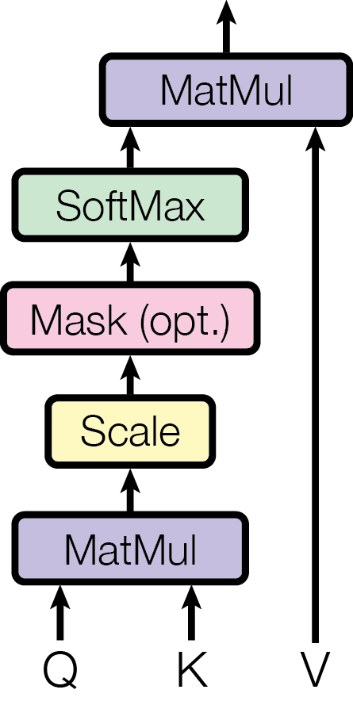{: style="width: 260px"}
Image source: [Attention Is All You Need](https://arxiv.org/abs/1706.03762), Figure 2 (left). The optional mask is used by the decoder, covered later.

### 2.3 Why divide by $\sqrt{d_k}$?

The argument has two parts: unscaled scores grow with $d_k$, and large scores break softmax's gradient.

#### The assumption

Take one entry of $QK^\top$, the score between query row $q$ (a row of $Q$) and key row $k$ (a row of $K$, i.e. a column of $K^\top$):

$$
s = q \cdot k = \sum_{i=1}^{d_k} q_i k_i
$$

Following a footnote in the paper, assume all $2d_k$ components $q_1, \dots, q_{d_k}, k_1, \dots, k_{d_k}$ are **mutually independent** random variables with

$$
\mathbb{E}[q_i] = \mathbb{E}[k_i] = 0, \qquad \mathrm{Var}(q_i) = \mathrm{Var}(k_i) = 1.
$$

This is an idealization.

#### Step 1: one term $q_i k_i$ has mean 0 and variance 1

By independence, the expectation of a product is the product of expectations:

$$
\mathbb{E}[q_i k_i] = \mathbb{E}[q_i]\,\mathbb{E}[k_i] = 0.
$$

For the variance, use $\mathrm{Var}(X) = \mathbb{E}[X^2] - \mathbb{E}[X]^2$ and $\mathbb{E}[X^2] = \mathrm{Var}(X) + \mathbb{E}[X]^2$. For independent $X$ and $Y$:

$$
\begin{aligned}
\mathrm{Var}(XY) &= \mathbb{E}[X^2]\,\mathbb{E}[Y^2] - \mathbb{E}[X]^2\,\mathbb{E}[Y]^2 \\
&= \big(\mathrm{Var}(X) + \mathbb{E}[X]^2\big)\big(\mathrm{Var}(Y) + \mathbb{E}[Y]^2\big) - \mathbb{E}[X]^2\,\mathbb{E}[Y]^2 \\
&= \mathrm{Var}(X)\,\mathrm{Var}(Y) + \mathrm{Var}(X)\,\mathbb{E}[Y]^2 + \mathrm{Var}(Y)\,\mathbb{E}[X]^2.
\end{aligned}
$$

With zero means the last two terms vanish:

$$
\mathrm{Var}(q_i k_i) = 1 \cdot 1 + 0 + 0 = 1.
$$

#### Step 2: the full score has variance $d_k$

The terms $q_1 k_1, \dots, q_{d_k} k_{d_k}$ involve disjoint sets of independent variables, so they are independent of each other, and the variance of a sum of independent variables is the sum of their variances:

$$
\mathbb{E}[s] = \sum_{i=1}^{d_k} \mathbb{E}[q_i k_i] = 0, \qquad
\mathrm{Var}(s) = \sum_{i=1}^{d_k} \mathrm{Var}(q_i k_i) = d_k.
$$

So the standard deviation of a raw score is $\sqrt{d_k}$. With $d_k = 64$ that is 8, and it keeps growing as heads get wider.

#### Step 3: scaling by $1/\sqrt{d_k}$ restores unit variance

For any constant $c$, $\mathrm{Var}(cX) = c^2\,\mathrm{Var}(X)$. Choosing $c = 1/\sqrt{d_k}$:

$$
\mathrm{Var}\!\left(\frac{q \cdot k}{\sqrt{d_k}}\right) = \frac{1}{d_k} \cdot d_k = 1.
$$

The scaled scores have mean 0 and variance 1 no matter how large $d_k$ is.

#### Step 4: why large scores are bad for softmax

Let $p = \mathrm{softmax}(z)$, so $p_i = e^{z_i} / \sum_j e^{z_j}$. Its Jacobian is

$$
\frac{\partial p_i}{\partial z_j} = p_i\,(\delta_{ij} - p_j),
$$

where $\delta_{ij}$ is 1 if $i = j$ and 0 otherwise. If one score dominates, $p$ becomes nearly one-hot: $p_m \approx 1$ and every other $p_i \approx 0$. Then every entry of the Jacobian is close to 0. The diagonal entry for $m$ is $p_m(1 - p_m) \approx 0$, and every other entry has a factor $p_i \approx 0$. The gradient that reaches $Q$ and $K$ passes through this Jacobian, so it nearly vanishes and learning stalls.

A concrete example: multiplying the scores by 8, the typical size of an unscaled score when $d_k = 64$, turns a soft distribution into an almost hard one.

| Scores $z$ | $\mathrm{softmax}(z)$ | Largest Jacobian entry |
|---|---|---|
| $(1,\ 0.5,\ 0)$ | $(0.51,\ 0.31,\ 0.19)$ | 0.25 |
| $(8,\ 4,\ 0)$ | $(0.98,\ 0.018,\ 0.0003)$ | 0.018 |

The gradients shrink by more than an order of magnitude. Dividing by $\sqrt{d_k}$ keeps the scores in the first row's regime, where softmax still distributes attention and passes gradient back.

> Without scaling, dot-product scores have variance $d_k$ and push softmax into its flat, one-hot regime where gradients vanish. Dividing by $\sqrt{d_k}$ brings the variance back to 1, whatever the head width.

### 2.4 The nature of self-attention

In self-attention, $Q = XW^Q$, $K = XW^K$ and $V = XW^V$ are all linear transformations of the same input $X$, through learned matrices. If we strip away the learned matrices (set $W^Q = W^K = W^V = I$) and drop the $\sqrt{d_k}$ scaling for a moment, the formula becomes

$$
\mathrm{SelfAttention}(X) = \mathrm{softmax}\!\left(XX^\top\right) X
$$

Take the prompt "Michigan go blue": three tokens, each embedded as a vector of length 4.

$$
X =
\begin{pmatrix}
1 & 1 & 0 & 0 \\
0 & 0 & 1 & 0 \\
1 & 0 & 0 & 1
\end{pmatrix}
\begin{matrix}
\leftarrow \text{Michigan} \\
\leftarrow \text{go} \\
\leftarrow \text{blue}
\end{matrix}
$$

#### Step 1: $XX^\top$, the attention scores

$X$ is $3 \times 4$ and $X^\top$ is $4 \times 3$, so $XX^\top$ is a $\mathbf{3 \times 3}$ matrix: one entry per *pair of tokens*, whatever the embedding width. Entry $(i, j)$ is the dot product of token $i$'s vector with token $j$'s vector:

$$
(XX^\top)_{ij} = x_i \cdot x_j = \lVert x_i \rVert\, \lVert x_j \rVert \cos\theta_{ij}
$$

A dot product measures similarity: it is large when two vectors point in the same direction and 0 when they share no features. The first row compares "Michigan" with every token:

$$
\begin{aligned}
x_{\text{Michigan}} \cdot x_{\text{Michigan}} &= 1 \cdot 1 + 1 \cdot 1 + 0 \cdot 0 + 0 \cdot 0 = 2 \\
x_{\text{Michigan}} \cdot x_{\text{go}} &= 1 \cdot 0 + 1 \cdot 0 + 0 \cdot 1 + 0 \cdot 0 = 0 \\
x_{\text{Michigan}} \cdot x_{\text{blue}} &= 1 \cdot 1 + 1 \cdot 0 + 0 \cdot 0 + 0 \cdot 1 = 1
\end{aligned}
$$

Doing this for every pair:

$$
XX^\top =
\begin{array}{r ccc}
 & \text{Michigan} & \text{go} & \text{blue} \\
\text{Michigan} & \color{crimson}{2} & \color{crimson}{0} & \color{crimson}{1} \\
\text{go} & 0 & 1 & 0 \\
\text{blue} & 1 & 0 & 2
\end{array}
$$

The highlighted first row says how much "Michigan" resembles each token in the prompt: itself most (2), then "blue" (1), and "go" not at all (0). This is why these numbers are called **attention scores**: row $i$ says how strongly token $i$ "attends" to every token.

Softmax turns each row into weights that sum to 1. For the first row, $\mathrm{softmax}(2, 0, 1) = (0.665,\ 0.090,\ 0.245)$, and for the whole matrix:

$$
A = \mathrm{softmax}(XX^\top) =
\begin{pmatrix}
\color{crimson}{0.665} & \color{crimson}{0.090} & \color{crimson}{0.245} \\
0.212 & 0.576 & 0.212 \\
0.245 & 0.090 & 0.665
\end{pmatrix}
$$

#### Step 2: $AX$, mixing the tokens

Multiplying the $3 \times 3$ weights by the $3 \times 4$ input gives a $3 \times 4$ output, the same shape as $X$. Entry $(1, 1)$ comes from the first row of $A$ and the first column of $X$:

$$
\begin{pmatrix}
\color{crimson}{0.665} & \color{crimson}{0.090} & \color{crimson}{0.245} \\
0.212 & 0.576 & 0.212 \\
0.245 & 0.090 & 0.665
\end{pmatrix}
\begin{pmatrix}
\color{#2f9e44}{1} & 1 & 0 & 0 \\
\color{#2f9e44}{0} & 0 & 1 & 0 \\
\color{#2f9e44}{1} & 0 & 0 & 1
\end{pmatrix}
\;\Rightarrow\;
0.665 \cdot 1 + 0.090 \cdot 0 + 0.245 \cdot 1 = 0.910
$$

Looking at the whole first row of the output at once, it is a weighted sum of the token vectors, where the weights are Michigan's attention scores:

$$
\begin{aligned}
\text{out}_{\text{Michigan}}
&= 0.665\, x_{\text{Michigan}} + 0.090\, x_{\text{go}} + 0.245\, x_{\text{blue}} \\
&= 0.665\,(1, 1, 0, 0) + 0.090\,(0, 0, 1, 0) + 0.245\,(1, 0, 0, 1) \\
&= (0.910,\ 0.665,\ 0.090,\ 0.245)
\end{aligned}
$$

In general, row $i$ of the output is

$$
\text{out}_i = \sum_{j=1}^{n} A_{ij}\, x_j ,
$$

each token's vector weighted by how much token $i$ attends to it. So **each row of the output is token $i$'s view of the entire prompt**. "Michigan" is still mostly itself, but its last dimension, which only "blue" has, went from 0 to 0.245: it has absorbed some of "blue" from its context. The full output is

$$
\mathrm{softmax}(XX^\top)\,X =
\begin{pmatrix}
0.910 & 0.665 & 0.090 & 0.245 \\
0.424 & 0.212 & 0.576 & 0.212 \\
0.910 & 0.245 & 0.090 & 0.665
\end{pmatrix}
\begin{matrix}
\leftarrow \text{Michigan} \\
\leftarrow \text{go} \\
\leftarrow \text{blue}
\end{matrix}
$$

> Each row of the self-attention output is one token's view of the whole input: a weighted sum of every token's vector, with weights set by similarity.

### 2.5 Multi-Head Attention

Multi-head attention runs $h$ attentions in parallel, each with its own smaller projections:

$$
\mathrm{head}_i = \mathrm{Attention}(XW_i^Q,\; XW_i^K,\; XW_i^V), \qquad W_i^Q, W_i^K, W_i^V \in \mathbb{R}^{d_{model} \times d_k}
$$

$$
\mathrm{MultiHead}(X) = \mathrm{Concat}(\mathrm{head}_1, \dots, \mathrm{head}_h)\, W^O, \qquad W^O \in \mathbb{R}^{h d_v \times d_{model}}
$$

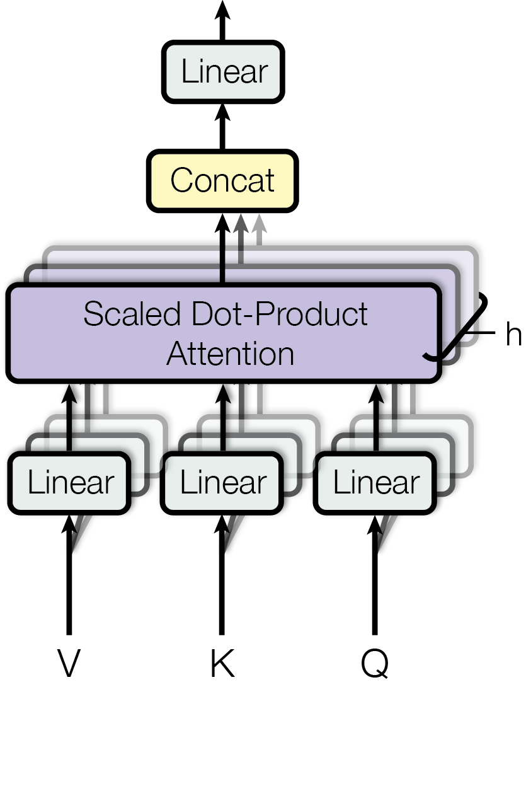{: style="width: 340px"}
Image source: [Attention Is All You Need](https://arxiv.org/abs/1706.03762), Figure 2 (right)

With $h = 8$ and $d_k = 512 / 8 = 64$, the total cost is about the same as a single head of width 512. We split the same budget into 8 subspaces instead of spending it on one. Each head can then specialize, and $W^O$ mixes their findings back together.

Why not stack more attention layers instead of adding heads? Compare one layer of $h$ heads with $h$ stacked single-head layers of the same width $d_k = d/h$, counting $W^Q, W^K, W^V$ and the output projection:

| | Parameters | Attention compute | Dependent steps |
|---|---|---|---|
| One layer, $h$ heads | $h \cdot 4\,d\,d_k = 4d^2$ | $h \cdot O(n^2 d_k) = O(n^2 d)$ | 1 |
| $h$ layers, 1 head each | $h \cdot 4\,d\,d_k = 4d^2$ | $h \cdot O(n^2 d_k) = O(n^2 d)$ | $h$ |

The parameters and the total work are the same. The difference is the shape of that work: heads do not depend on each other, so all $h$ are one batched matrix multiplication with the heads as an extra tensor dimension, while stacked layers must run one after another. That makes multi-head the more GPU-friendly way to spend the budget.

The two are not interchangeable, though. Heads give several views of the same input in one hop, while stacking lets a later layer attend over what earlier layers already mixed. So the Transformer uses both: 8 heads in each of 6 layers.

> Multi-head attention spends the same parameters and compute as stacking narrow single-head layers, but in one parallel step instead of $h$ sequential ones.

## 3. Positional Encoding

### 3.1 Why we need positions

Attention, as we saw, is a weighted sum over a *set* of vectors. In the previous example, the $A$ of "Michigan" (first row of $A$) over "Michigan go blue" would be the same as over "go Michigan blue". It has no notion of order.

An RNN got order for free from reading tokens one by one; having dropped the recurrence, we must inject position information explicitly. As Mehreen Saeed puts it in [A Gentle Introduction to Positional Encoding in Transformer Models](https://machinelearningmastery.com/a-gentle-introduction-to-positional-encoding-in-transformer-models-part-1/):

> Positional encoding describes the location or position of an entity in a sequence so that each position is assigned a unique representation.

Before the real solution, two simple ideas that do not work.

**Idea 1: use the index itself.** Add $k$ to every dimension of token $k$'s embedding: $0, 1, 2, \dots$ For "Michigan go blue" that is

$$
x_{\text{Michigan}} + 0, \qquad x_{\text{go}} + 1, \qquad x_{\text{blue}} + 2.
$$

This is fine for three tokens but not for a long document. Embedding entries are of order 1, while the index of token 500 is 500, so the position completely swamps the word's meaning, and later tokens differ mostly in how *large* they are. Large inputs also make large attention scores. If every entry of $x_k$ is shifted by roughly $k$, then

$$
x_k \cdot x_m \approx \sum_{l=1}^{d} k \cdot m = d\,k\,m,
$$

which for $k = m = 500$ and $d = 512$ is about $1.3 \times 10^{8}$. As shown in 2.3, scores this large push softmax into its saturated, nearly one-hot regime, where the gradients vanish. The model would also meet, at test time, index values larger than any it saw in training.

**Idea 2: normalize the index to $[0, 1]$.** Use $k / (L - 1)$ for a sentence of length $L$, so values stay small. But now the same number means different things in different sentences:

| Sentence | Length $L$ | Encodings |
|---|---|---|
| "Michigan go blue" | 3 | $0,\ 0.5,\ 1$ |
| "Michigan go blue team" | 4 | $0,\ 0.33,\ 0.67,\ 1$ |

In the first sentence a gap of $0.5$ means "neighbors"; in the second, neighbors are $0.33$ apart, and $0.5$ does not correspond to any distance at all. "go" is encoded as $0.5$ in one sentence and $0.33$ in the other, though it is the second token in both. In the article's words, "if you normalize the index value to lie between 0 and 1, it can create problems for variable length sequences as they would be normalized differently."

So we want an encoding that is **bounded** (like idea 2), **independent of sentence length** (like idea 1), and **unique for every position**. Sines and cosines give all three.

### 3.2 Sinusoidal positional encoding

The paper instead builds a fixed vector of sines and cosines for each position and **adds** it to that token's embedding. Following the article's notation, the positional encoding matrix $P$ has one row per position and one column per embedding dimension:

$$
\begin{aligned}
P(k, 2i) &= \sin\!\left(\frac{k}{n^{2i/d}}\right) \\
P(k, 2i+1) &= \cos\!\left(\frac{k}{n^{2i/d}}\right)
\end{aligned}
$$

where

- $k$ is the position of the token in the sequence ($k = 0, 1, 2, \dots$),
- $d$ is the embedding dimension ($d_{model}$),
- $i$ indexes pairs of columns, $0 \le i < d/2$: column $2i$ gets a sine and column $2i+1$ gets a cosine of the same frequency,
- $n$ is a constant, set to $10000$ in the paper.

#### Unfolding the formula: "Michigan go blue"

Back to our three tokens, now with embedding dimension $d = 6$ and the paper's $n = 10000$. The positions are $k = 0, 1, 2$, and the column pairs are $i = 0$ (columns 0, 1), $i = 1$ (columns 2, 3) and $i = 2$ (columns 4, 5).

Write $D_i = n^{2i/d} = 10000^{2i/6}$ for the denominator of pair $i$, so $D_0 = 10000^{0/6} = 1$, $D_1 = 10000^{2/6} \approx 21.5$ and $D_2 = 10000^{4/6} \approx 464$. Plugging each $(k, j)$ into the formula, slot by slot:

$$
P =
\begin{array}{r cccccc}
 & j = 0 & j = 1 & j = 2 & j = 3 & j = 4 & j = 5 \\
\text{Michigan} & \color{crimson}{\sin\tfrac{0}{D_0}} & \cos\tfrac{0}{D_0} & \color{#2f9e44}{\sin\tfrac{0}{D_1}} & \cos\tfrac{0}{D_1} & \sin\tfrac{0}{D_2} & \cos\tfrac{0}{D_2} \\
\text{go} & \color{crimson}{\sin\tfrac{1}{D_0}} & \cos\tfrac{1}{D_0} & \color{#2f9e44}{\sin\tfrac{1}{D_1}} & \cos\tfrac{1}{D_1} & \sin\tfrac{1}{D_2} & \cos\tfrac{1}{D_2} \\
\text{blue} & \color{crimson}{\sin\tfrac{2}{D_0}} & \cos\tfrac{2}{D_0} & \color{#2f9e44}{\sin\tfrac{2}{D_1}} & \cos\tfrac{2}{D_1} & \sin\tfrac{2}{D_2} & \cos\tfrac{2}{D_2}
\end{array}
$$

$$
\begin{array}{r cccccc}
 & \sin\tfrac{k}{D_0} & \cos\tfrac{k}{D_0} & \sin\tfrac{k}{D_1} & \cos\tfrac{k}{D_1} & \sin\tfrac{k}{D_2} & \cos\tfrac{k}{D_2} \\
\text{Michigan} & \color{crimson}{0} & 1 & \color{#2f9e44}{0} & 1 & 0 & 1 \\
\text{go} & \color{crimson}{0.841} & 0.540 & \color{#2f9e44}{0.046} & 0.999 & 0.002 & 1.000 \\
\text{blue} & \color{crimson}{0.909} & -0.416 & \color{#2f9e44}{0.093} & 0.996 & 0.004 & 1.000
\end{array}
$$

Look at the red column. Its three slots share one formula, $\sin(k / D_0) = \sin(k)$, and only $k$ changes. So the column is the **same sine wave sampled at $k = 0, 1, 2$**. The green column is likewise one wave, $\sin(k / D_1) = \sin(k / 21.5)$, just a much slower one:

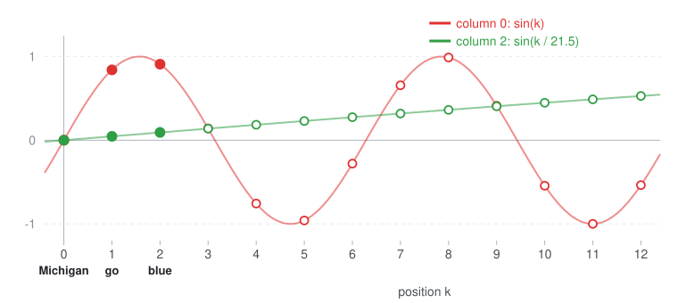

The filled dots are "Michigan", "go" and "blue"; the hollow dots show where tokens 3 to 12 of a longer sentence would land on the same curves. The red wave completes a full cycle every $2\pi \approx 6.3$ tokens. The green wave is a sine too, but its period is $2\pi \times 21.5 \approx 135$ tokens, so over these 13 positions we only see the start of its first rise.

> Each column of the positional encoding is one sine or cosine wave over positions, and each token's encoding is where its position lands on all of those waves, each with a different frequency.

#### A better picture: a clock with $d/2$ hands

Reading the matrix column by column gives waves. Reading it **row by row, two columns at a time**, gives something simpler. Columns $2i$ and $2i+1$ are the sine and cosine of the *same* angle $\omega_i k$, where $\omega_i = 1/n^{2i/d}$:

$$
\big(P(k, 2i+1),\; P(k, 2i)\big) = \big(\cos(\omega_i k),\; \sin(\omega_i k)\big).
$$

Since $\cos^2\theta + \sin^2\theta = 1$, this pair is a **point on the unit circle at angle $\omega_i k$**. Moving from token $k$ to token $k+1$ rotates the point by the fixed angle $\omega_i$. For "Michigan go blue", with column 1 on the horizontal axis and column 0 on the vertical axis (and likewise columns 3 and 2):

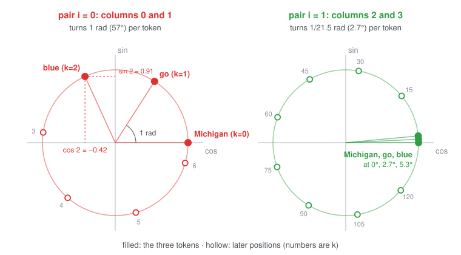

- **Pair $i = 0$ (red)** is a fast hand: it turns 1 radian per token, so "Michigan", "go" and "blue" sit at $0$, $1$ and $2$ radians, clearly apart. After about 6 tokens it has gone all the way around.
- **Pair $i = 1$ (green)** is a slow hand: it turns only $1/21.5$ radian ($2.7°$) per token, so the three tokens are nearly on top of each other, and it takes about 135 tokens to go around once.

> Each token's positional encoding is a unique combination of points on unit circles, one circle per (sin, cos) pair, each turning at its own speed.

## 4. Cross-Attention

So far every attention we have seen is **self**-attention: queries, keys and values all come from the same sequence. The full Transformer has a second kind.

{: width="420"}
Image source: [Attention Is All You Need](https://arxiv.org/abs/1706.03762), Figure 1

The left stack is the **encoder** and the right stack is the **decoder**. Both start each layer with a self-attention sub-layer; the decoder's is masked so a token cannot look at later tokens (section 6.3). The decoder layer then has an extra sub-layer in the middle, the one with two arrows coming in from the encoder: **cross-attention** (the paper calls it encoder-decoder attention). The encoder never does cross-attention.

### Where Q, K and V come from

Cross-attention uses the same formula as self-attention. The only difference is where the inputs come from:

$$
Q = X_{dec}\, W^Q, \qquad K = X_{enc}\, W^K, \qquad V = X_{enc}\, W^V
$$

$$
\mathrm{CrossAttention}(X_{dec}, X_{enc}) = \mathrm{softmax}\!\left(\frac{QK^\top}{\sqrt{d_k}}\right) V
$$

- The **queries** come from the decoder: "for the word I am about to write, what do I need from the source?"
- The **keys and values** come from the encoder's final output: "here is what each source word contains."

In dictionary terms (2.1), the encoder builds the dictionary and the decoder looks things up in it. Sebastian Raschka's diagram shows the shapes, with "Inputs 1" ($n$ tokens) playing the decoder and "Inputs 2" ($m$ tokens) playing the encoder:

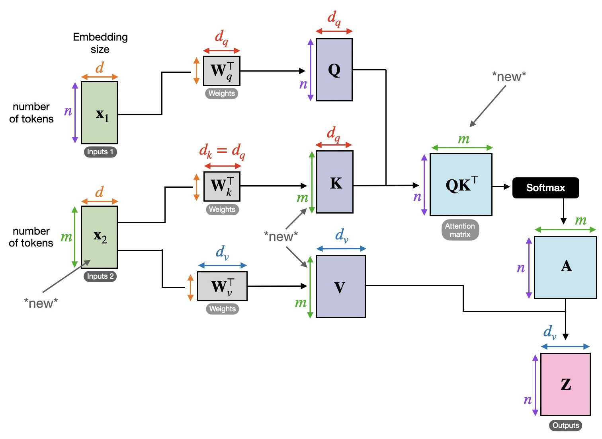
Image source: S. Raschka, [Understanding and Coding the Self-Attention Mechanism of Large Language Models From Scratch](https://sebastianraschka.com/blog/2023/self-attention-from-scratch.html)

Following the shapes through, with $n$ decoder tokens and $m$ encoder tokens:

$$
\underbrace{Q}_{n \times d_k}\;
\underbrace{K^\top}_{d_k \times m}
= \underbrace{QK^\top}_{n \times m},
\qquad
\underbrace{A}_{n \times m}\;
\underbrace{V}_{m \times d_v}
= \underbrace{Z}_{n \times d_v}
$$

- $A$ is $n \times m$: **one row per decoder token, one column per encoder token**. Row $i$ is how much decoder token $i$ attends to each source token, and it sums to 1.
- $Z$ is $n \times d_v$: its leading dimension is the **number of decoder tokens**, not encoder tokens. Each row of $Z$ is a weighted mix of encoder values, one per decoder token: what that decoder token "read" from the source. This has to be so, because $Z$ is added back to the decoder's residual stream, which has one row per decoder token.
- $n$ and $m$ need not be equal. A 3-word English sentence can become a 4-token German one.

> In cross-attention the decoder asks and the encoder answers: $Q$ comes from the decoder, $K$ and $V$ from the encoder, and the output has one row per decoder token.

Two more details:

- **No mask.** Cross-attention is not masked: the whole source sentence is known before decoding starts, so every decoder token may look at every source token. Only the decoder's *self*-attention needs the causal mask.
- **One memory, every layer.** The encoder runs once, and its top-layer output, often called the **memory**, supplies $K$ and $V$ to the cross-attention of *every* decoder layer. Each decoder layer has its own $W^K$ and $W^V$, so each can read the memory differently. At inference time the memory's keys and values never change, so they are computed once per source sentence.

## 5. Layer Normalization

Every attention and feed-forward sub-layer in the architecture figure of section 4 is followed by an "Add & Norm" box:

$$
x_{\text{out}} = \mathrm{LayerNorm}\big(x + \mathrm{Sublayer}(x)\big)
$$

"Add" is the residual connection, which lets the sub-layer learn only a correction to its input. "Norm" is **layer normalization**, and the choice of *which* normalization, and *where* to put it, turns out to matter a lot.

Normalization techniques all target gradient control and stable training. The question is what LayerNorm normalizes *over*.

### 5.1 LayerNorm vs BatchNorm

Both subtract a mean, divide by a standard deviation, and then apply a learned scale $\gamma$ and shift $\beta$. They differ in which numbers the mean and standard deviation are computed over.

Think of the activations as a matrix with one row per token (all tokens of all sentences in the batch) and one column per feature:

- **BatchNorm** normalizes each **column**: feature $j$ is normalized using the mean and variance of feature $j$ *across all tokens in the batch*.
- **LayerNorm** normalizes each **row**: token $t$'s vector is normalized using the mean and variance of *its own $d$ features*.

Take our "Michigan go blue" vectors from 2.4 as a batch of three tokens with $d = 4$ (ignoring $\epsilon$):

$$
X =
\begin{array}{r cccc}
 & f_1 & f_2 & f_3 & f_4 \\
\text{Michigan} & 1 & 1 & 0 & 0 \\
\text{go} & 0 & 0 & 1 & 0 \\
\text{blue} & 1 & 0 & 0 & 1
\end{array}
$$

**LayerNorm**, row by row. "Michigan" has mean $0.5$ and standard deviation $0.5$:

$$
\mathrm{LN}(x_{\text{Michigan}}) = \left(\tfrac{1 - 0.5}{0.5},\ \tfrac{1 - 0.5}{0.5},\ \tfrac{0 - 0.5}{0.5},\ \tfrac{0 - 0.5}{0.5}\right) = (1,\ 1,\ -1,\ -1)
$$

This uses only Michigan's own four numbers. Whatever else is in the batch, Michigan always comes out as $(1, 1, -1, -1)$.

**BatchNorm**, column by column. Feature $f_1$ is $(1, 0, 1)$ across the three tokens, with mean $0.667$ and standard deviation $0.471$, so Michigan's $f_1$ becomes $(1 - 0.667)/0.471 = 0.71$. Doing every column:

$$
\mathrm{BN}(X) =
\begin{array}{r cccc}
\text{Michigan} & 0.71 & 1.41 & -0.71 & -0.71 \\
\text{go} & -1.41 & -0.71 & 1.41 & -0.71 \\
\text{blue} & 0.71 & -0.71 & -0.71 & 1.41
\end{array}
$$

> BatchNorm normalizes each feature across the batch, so a token's output depends on its batchmates. LayerNorm normalizes each token across its own features, so it behaves identically for any batch size, any sequence length, and in training and inference alike.

BatchNorm works well for images, where batches are large and every image has the same shape. Text has none of those properties.

### 5.2 Post-norm, pre-norm, and the trend

The original Transformer puts LayerNorm **after** the residual addition. Many later models, including LLaMA, put it **before** the sub-layer:

$$
\text{Post-LN (2017):}\quad x_{l+1} = \mathrm{LN}\big(x_l + F_l(x_l)\big)
\qquad\qquad
\text{Pre-LN:}\quad x_{l+1} = x_l + F_l\big(\mathrm{LN}(x_l)\big)
$$

where $F_l$ is the attention or feed-forward sub-layer.

The difference shows up when you unroll the stack. With pre-LN, the residual path carries the input straight to the output, and each layer only adds to it:

$$
x_L = x_0 + \sum_{l=0}^{L-1} F_l\big(\mathrm{LN}(x_l)\big)
$$

There is a clean "highway" from the loss back to every layer, so gradients reach the bottom of a deep stack without being repeatedly rescaled. With post-LN, every LayerNorm sits *on* that highway, and the gradient passes through all of them. [Xiong et al. (2020)](https://arxiv.org/abs/2002.04745) proved that at initialization this makes the gradients near the output large, which is why post-LN Transformers benefit from a learning-rate warmup (the paper grows the learning rate linearly for the first 4000 steps). Pre-LN gradients are well-behaved at initialization, so pre-LN models can train without warmup.

The trend since 2017:

- **Pre-LN became common.** [LLaMA](https://arxiv.org/abs/2302.13971), for example, normalizes the input of each sub-layer instead of its output.
- **RMSNorm is a popular replacement for LayerNorm.** LLaMA and Gemma 2 both use it. It skips the mean subtraction and the shift $\beta$ and only rescales by the root mean square, $\mathrm{RMSNorm}(x) = \gamma \odot x / \sqrt{\tfrac{1}{d}\sum_j x_j^2 + \epsilon}$. [Zhang and Sennrich (2019)](https://arxiv.org/abs/1910.07467) report performance comparable to LayerNorm with 7% to 64% less running time.
- **Pre-LN is not free.** Its gradients tend to be larger at earlier layers than at later ones, which [DeepNet](https://arxiv.org/abs/2203.00555) (Wang et al., 2022) gives as a presumed cause of pre-LN's slightly worse translation quality than post-LN. Some recent models normalize both the input and the output of each sub-layer, $x + \mathrm{Norm}(F(\mathrm{Norm}(x)))$, for example [Gemma 2](https://arxiv.org/abs/2408.00118).

> Post-norm, the 2017 original, has large gradients near the output at initialization and benefits from warmup. Pre-norm gradients are well-behaved at initialization, and many later models such as LLaMA use it, often with RMSNorm.

## 6. Training and Inference

### 6.1 Which architecture for which task

The original Transformer is an encoder-decoder, but the two stacks also work on their own, and later models use all three combinations:

| Architecture | Attention | Trained to | Typical tasks | Examples |
|---|---|---|---|---|
| **Encoder-only** | unmasked self | fill in hidden words | classification, tagging, embeddings | BERT, RoBERTa |
| **Encoder-decoder** | unmasked self; masked self + cross | predict the next output token | translation, summarization, speech recognition | T5, BART, Whisper |
| **Decoder-only** | masked self | predict the next token | generation, chat, code | GPT, LLaMA, Mistral |

A few points the table hides:

- **Encoder-only models do not generate text.** They turn an input into vectors, and a small head on top (for example a linear layer plus softmax over the classes) makes the decision. Since they never generate, they do not need teacher forcing or a causal mask, so the rest of this section is about the other two.
- **Today's LLMs are almost all decoder-only.** Encoder-decoder LLMs exist (T5, Flan-T5), but general-purpose models have mostly gone decoder-only: one stack, one objective (next token). A decoder-only model handles "input → output" tasks by putting the input in front as a prompt.
- **Encoder-decoder is still used where the input is of a different kind from the output**, such as audio in and text out (Whisper).
- **Beyond text.** The Vision Transformer (ViT) cuts an image into patches, for example 16x16, and treats them as tokens, and the same block now appears in speech, protein structure and many other areas.

> Encoder-only models understand, encoder-decoder models transform one sequence into another, and decoder-only models continue text. Today's general-purpose LLMs are almost all decoder-only.

#### Encoder-decoder vs decoder-only, side by side

Throughout this section we translate the English sentence "I love cats" into the German "Ich liebe Katzen". Both generating architectures are trained to predict the next token at every position at once, from inputs and labels arranged as below. 6.2 explains why the inputs are arranged this way (teacher forcing), and 6.3 how the model is kept from peeking at the labels.

**Encoder-decoder.** The source and the target go into different stacks:

- **Encoder sees:** `I love cats`, all three tokens at once, with no mask.
- **Decoder sees:** the target shifted right behind a `<bos>` token, through masked self-attention, plus the encoder's output through cross-attention in every decoder block.

| Position | 1 | 2 | 3 | 4 |
|---|---|---|---|---|
| Decoder input | `<bos>` | Ich | liebe | Katzen |
| Label | Ich | liebe | Katzen | `<eos>` |

At **inference**, the encoder still sees `I love cats`, once. The decoder input starts as just `<bos>` and grows by one generated token per step.

**Decoder-only.** There is only one stack, so source and target are joined into one sequence, `German: I love cats => Ich liebe Katzen <eos>`, and the labels are the same sequence shifted left by one:

| Position | 1 | 2 | 3 | 4 | 5 | 6 | 7 | 8 |
|---|---|---|---|---|---|---|---|---|
| Input | German: | I | love | cats | => | Ich | liebe | Katzen |
| Label | I | love | cats | => | Ich | liebe | Katzen | `<eos>` |
| In the loss? | no | no | no | no | yes | yes | yes | yes |

- **The model sees:** the whole sequence, through masked self-attention. The source is read left to right like everything else, and the target reaches it by attending back to earlier positions, not through cross-attention.
- **The loss:** when training on prompt-answer pairs like this one, usually only the answer positions are graded (5 to 8). The model still reads the prompt, but it is not graded on predicting the prompt itself. When pretraining on plain text, every position is graded.

At **inference**, the model gets `German: I love cats =>` and generates "Ich", "liebe", "Katzen", `<eos>` one at a time (more in 6.4).

The rest of the section uses the encoder-decoder version; everything carries over to decoder-only by treating the prompt as part of the input sequence.

### 6.2 Teacher forcing

The decoder's job is always the same: given the source sentence (through cross-attention) and the target tokens produced so far, predict the **next** target token. It starts from a special `<bos>` (beginning of sequence) token and stops when it predicts `<eos>` (end of sequence).

#### The naive way: feed the model its own predictions

The obvious way to train is to do what we will do at inference time: run the decoder, take its prediction, append it, run again. Suppose early in training the model gets the second word wrong:

| Step | Decoder input | Model predicts | Correct answer |
|---|---|---|---|
| 1 | `<bos>` | Ich | Ich |
| 2 | `<bos> Ich` | **hasse** ("hate") | liebe |
| 3 | `<bos> Ich hasse` | Hunde | Katzen |
| 4 | `<bos> Ich hasse Hunde` | `<eos>` | `<eos>` |

Two things go wrong:

1. **Mistakes compound.** From step 3 on, the model is conditioned on a sentence that is not the translation, and we would be asking it to produce "Katzen" after "Ich hasse". A bad early guess turns the rest of the training example into noise, and an untrained model makes bad guesses all the time, so learning is slow and unstable.
2. **It is sequential.** Step 3 cannot start before step 2 has produced its token. That is the RNN problem from section 1 all over again, and it would throw away the Transformer's main advantage.

#### The fix: always feed the ground truth

**Teacher forcing** ignores what the model predicted and always feeds the *correct* previous tokens, as if a teacher corrected the student after every word. The decoder input is the target sentence shifted right by one, with `<bos>` in front, and the labels are the target sentence followed by `<eos>`:

$$
\begin{aligned}
\text{decoder input} &= (\texttt{<bos>},\ \text{Ich},\ \text{liebe},\ \text{Katzen}) \\
\text{labels} &= (\text{Ich},\ \text{liebe},\ \text{Katzen},\ \texttt{<eos>})
\end{aligned}
$$

Position $t$ sees the true tokens up to $t$ and must predict token $t+1$:

| Position $t$ | Decoder sees | Label |
|---|---|---|
| 1 | `<bos>` | Ich |
| 2 | `<bos> Ich` | liebe |
| 3 | `<bos> Ich liebe` | Katzen |
| 4 | `<bos> Ich liebe Katzen` | `<eos>` |

Even if the model guessed "hasse" at position 2, position 3 still sees the true "liebe" and is asked for "Katzen", a sensible question.

> Teacher forcing always feeds the decoder the true previous tokens, never its own predictions. Every position gets a clean training signal, and all positions can be trained in one forward pass.

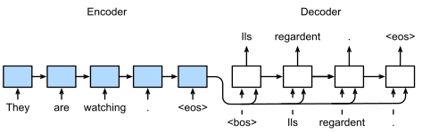
Image source: [Dive into Deep Learning, Fig. 10.7.1](https://d2l.ai/chapter_recurrent-modern/seq2seq.html) (CC BY-SA 4.0). The figure uses an RNN translating English into French, but the arrangement of decoder inputs ("&lt;bos&gt; Ils regardent .") and labels ("Ils regardent . &lt;eos&gt;") is exactly the same for a Transformer.

### 6.3 Masked self-attention

Teacher forcing computes all four predictions in **one forward pass**, as the four rows of one matrix. The mask lives in the decoder's first sub-layer, its **self-attention**, where $Q$, $K$ and $V$ all come from the same decoder input `<bos> Ich liebe Katzen`, so the attention matrix is $4 \times 4$: one row per decoder position, one column per decoder token it may look at. (Cross-attention, where $K$ and $V$ come from the encoder, is not masked; see section 4.)

#### What goes wrong without the mask

Line up each decoder position with its label: **the label of row $i$ is exactly the input token in row $i+1$**. Without a mask, row $i$ can see column $i+1$, so the model only needs one attention head that does "look at the next position":

- the query of position $i$ learns to match the key of position $i+1$, which is easy with positional encodings, since position $k+1$'s encoding is a fixed rotation of position $k$'s (section 3);
- $V$ carries the token's identity, so the row's output is roughly the next token's embedding;
- the final linear layer maps that embedding straight back to the same word.

That head's **decoder self-attention matrix** during training (the numbers here are illustrative), rows being decoder positions (queries) and columns the decoder tokens they look at (keys), with each row's label on the right:

$$
A_{\text{no mask}} =
\begin{array}{r cccc l}
 & \texttt{<bos>} & \text{Ich} & \text{liebe} & \text{Katzen} & \quad \text{label} \\
\texttt{<bos>} & 0.01 & \color{crimson}{\mathbf{0.97}} & 0.01 & 0.01 & \quad \color{crimson}{\text{Ich}} \\
\text{Ich} & 0.01 & 0.01 & \color{crimson}{\mathbf{0.97}} & 0.01 & \quad \color{crimson}{\text{liebe}} \\
\text{liebe} & 0.01 & 0.01 & 0.01 & \color{crimson}{\mathbf{0.97}} & \quad \color{crimson}{\text{Katzen}} \\
\text{Katzen} & 0.25 & 0.25 & 0.25 & 0.25 & \quad \texttt{<eos>}
\end{array}
$$

The red weights sit just right of the diagonal, on exactly the column holding each row's label. Row `<bos>` must predict "Ich", and "Ich" is sitting in column 2 of its own input.

Row `<bos>` outputs about $0.97\, v_{\text{Ich}}$, which the output layer turns into $p(\text{Ich}) \approx 0.99$. The training loss collapses:

| Row | Label | $p(\text{label})$ | Loss $-\log p$ |
|---|---|---|---|
| `<bos>` | Ich | 0.99 | 0.01 |
| Ich | liebe | 0.99 | 0.01 |
| liebe | Katzen | 0.99 | 0.01 |
| Katzen | `<eos>` | 0.95 | 0.05 |

The average is about 0.02, and the model got there **without using the source sentence at all**: cross-attention to "I love cats" is unnecessary when the answer is already in the decoder input. Gradient descent tends to find this shortcut, because learning one "copy the neighbor" pattern lowers the loss far faster than learning to translate.

Then inference starts, and there is nothing to copy. Ask this model to translate "I love cats". At step 1 the decoder input is just `<bos>`, so the self-attention matrix is $1 \times 1$:

$$
A_{\text{step 1}} =
\begin{array}{r c l}
 & \texttt{<bos>} & \quad \text{should predict} \\
\texttt{<bos>} & 1.0 & \quad \text{Ich}
\end{array}
$$

The copy head looks for column 2, but column 2 does not exist yet: it is the very token the model is supposed to produce. In training, there was exactly one row that never had a next column to copy from, the last one, and its label was always `<eos>`. So the model has learned "nothing to my right means the sentence is over":

| Step | Decoder input | Self-attention row of the last position | Prediction |
|---|---|---|---|
| 1 | `<bos>` | $[1.0]$: nothing to the right to copy | `<eos>` |

The most likely translation of "I love cats" is an **empty sentence**, after a training loss of 0.02. Even if we forbid `<eos>` and force it to continue, every step is in the same situation, the last row with nothing to its right, and the model has never learned to look at "I love cats" through cross-attention, so the output is still garbage. The learned skill, "read the answer from the next column", needs exactly the token the model is supposed to produce.

The masked model, trained to predict each word from the past and the source alone, is in the same situation at inference as it was in training (6.4 walks through that loop).

#### The causal mask

The fix is to make training look like inference. At inference, when the decoder produces token $t+1$, the tokens after position $t$ do not exist yet. The **causal mask** recreates that during training: the future tokens are in the input matrix, but every position is blind to them. It is added to the scores before the softmax:

$$
\mathrm{MaskedAttention}(Q, K, V) = \mathrm{softmax}\!\left(\frac{QK^\top}{\sqrt{d_k}} + M\right) V,
\qquad
M_{ij} =
\begin{cases}
0 & j \le i \\
-\infty & j > i
\end{cases}
$$

Since $e^{-\infty} = 0$, every future position gets weight exactly 0, and the remaining weights in each row still sum to 1. For example, with some scaled scores $QK^\top / \sqrt{d_k}$:

$$
\begin{array}{r cccc}
 & \texttt{<bos>} & \text{Ich} & \text{liebe} & \text{Katzen} \\
\texttt{<bos>} & 1.0 & 0.2 & 0.8 & 0.4 \\
\text{Ich} & 0.6 & 1.5 & 0.9 & 0.3 \\
\text{liebe} & 0.3 & 1.1 & 1.8 & 1.4 \\
\text{Katzen} & 0.2 & 0.7 & 1.6 & 2.0
\end{array}
\;\xrightarrow{\;+M\;}\;
\begin{array}{cccc}
1.0 & \color{crimson}{-\infty} & \color{crimson}{-\infty} & \color{crimson}{-\infty} \\
0.6 & 1.5 & \color{crimson}{-\infty} & \color{crimson}{-\infty} \\
0.3 & 1.1 & 1.8 & \color{crimson}{-\infty} \\
0.2 & 0.7 & 1.6 & 2.0
\end{array}
\;\xrightarrow{\;\text{softmax}\;}\;
\begin{array}{cccc}
1 & 0 & 0 & 0 \\
0.29 & 0.71 & 0 & 0 \\
0.13 & 0.29 & 0.58 & 0 \\
0.08 & 0.13 & 0.32 & 0.47
\end{array}
$$

The result is **lower triangular**, and the copy shortcut is gone. Row `<bos>` now sees only `<bos>`, so nothing in what it can see says "Ich". The only way to lower its loss is through cross-attention: look at "I love cats" and learn that a sentence starting with "I" tends to become one starting with "Ich". Row $t$ depends only on tokens $1 \dots t$ and the source, exactly the "Decoder sees" column of the table in 6.2, and exactly what it will have at inference. One masked matrix computation does the work of the four sequential steps.

> The causal mask makes training look like inference: each position sees only itself and the tokens before it, so it cannot copy its label and has to learn to predict the next token from the past and the source.

### 6.4 Inference

At inference time there is no target sentence to feed in, so teacher forcing is impossible. The decoder runs **autoregressively**, feeding back its own predictions:

1. Encode the source sentence once. Its output, the keys and values for cross-attention, stays fixed for the rest of the translation.
2. Start the decoder with `<bos>`. Take the distribution at the **last** position and pick a token (greedy: the most likely one; or beam search, which keeps the few best partial sentences).
3. Append that token to the decoder input and run again.
4. Stop when the model predicts `<eos>`.

| Step | Decoder input | Prediction at last position |
|---|---|---|
| 1 | `<bos>` | Ich |
| 2 | `<bos> Ich` | liebe |
| 3 | `<bos> Ich liebe` | Katzen |
| 4 | `<bos> Ich liebe Katzen` | `<eos>` |

This is the "naive" table from 6.2, except that now there is no correct answer to fall back on: if the model says "hasse" at step 2, the translation continues from "Ich hasse".

Jay Alammar's animations show the whole process for a French-to-English example. First the encoder processes "Je suis étudiant" and the decoder produces the first word:

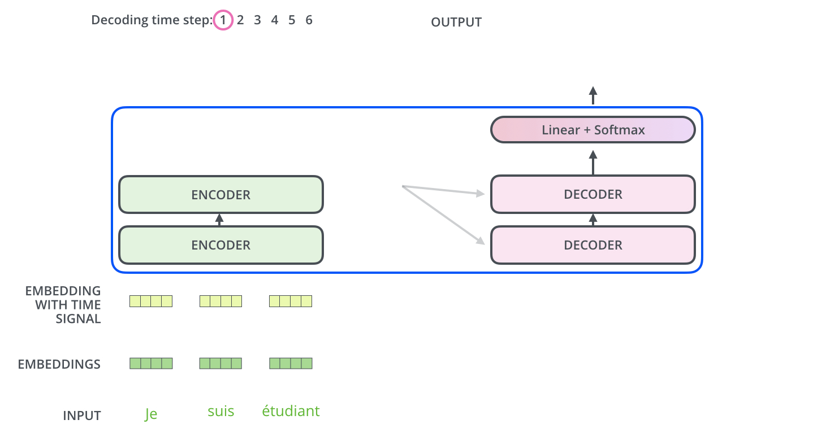
Image source: J. Alammar, [The Illustrated Transformer](https://jalammar.github.io/illustrated-transformer/) (CC BY-NC-SA 4.0)

Then each output is fed back into the bottom of the decoder, until it emits the end-of-sentence symbol:

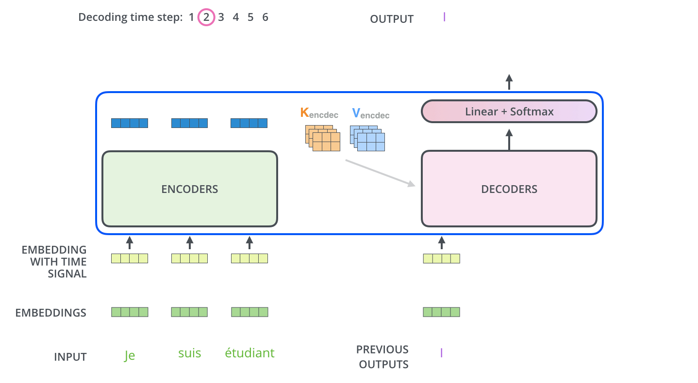
Image source: J. Alammar, [The Illustrated Transformer](https://jalammar.github.io/illustrated-transformer/) (CC BY-NC-SA 4.0)

The same loop in Dive into Deep Learning's notation; compare its decoder inputs with the teacher-forcing figure in 6.2:

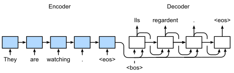
Image source: [Dive into Deep Learning, Fig. 10.7.3](https://d2l.ai/chapter_recurrent-modern/seq2seq.html) (CC BY-SA 4.0)

Training and inference side by side:

| | Training (teacher forcing) | Inference |
|---|---|---|
| Decoder input | true target, shifted right | the model's own predictions so far |
| Decoder passes per sentence | 1 | one per generated token |
| Positions computed | all at once, kept honest by the mask | only the new last position is needed |
| A wrong prediction | is corrected at the next position | is kept and built upon |

#### Decoder-only: prefill, then decode

A decoder-only model runs the same loop, with the prompt playing the role of the encoder's input. Inference has two phases:

1. **Prefill.** The whole prompt, `German: I love cats =>`, goes through the model in **one parallel pass**, just like a training forward pass. This computes the keys and values of every prompt token, and the distribution at the last position gives the first answer token, "Ich".
2. **Decode.** From then on, one token at a time: append "Ich", run, get "liebe"; append "liebe", run, get "Katzen"; and so on until `<eos>`.

| | Encoder-decoder | Decoder-only |
|---|---|---|
| Read the input | encoder pass, once | prefill pass over the prompt, once |
| Input is seen | bidirectionally, by the encoder | left to right, through the causal mask |
| Output tokens look at the input via | cross-attention to the encoder's memory | self-attention to the prompt tokens' keys and values |
| Generate the output | one decoder pass per token | one pass per token |

Prefill is fast because it is parallel, like training. Decode is slow per token, because each step is a whole pass through the model for one new token. This split is why LLM APIs report "time to first token" (mostly prefill) separately from "tokens per second" (decode).

#### The KV cache

Run naively, step $t$ recomputes the keys and values of all $t$ earlier tokens, in every decoder layer. But thanks to the causal mask, earlier tokens never attend to later ones, so their keys and values never change once computed. We can store them and, at each step, compute $Q$, $K$ and $V$ only for the one new token, then attend from it to the cached keys and values. This is the **KV cache**. It turns each step from reprocessing the whole prefix into processing a single token. The price is memory: the cache grows with every generated token, for every layer and every head.

> Training is parallel, one pass per sentence; inference is sequential, one pass per generated token. The KV cache means each of those passes computes $Q$, $K$ and $V$ for one new token only, at the price of memory that grows with every token.

## 7. How Big and How Expensive?

### 7.1 Parameters of the base model

| Part | Calculation | Parameters |
|---|---|---|
| Attention block | $4 \times 512 \times 512$ ($W^Q, W^K, W^V, W^O$) | ~1.05M |
| FFN block | $2 \times 512 \times 2048$ | ~2.1M |
| Encoder layer | 1 attention + 1 FFN | ~3.15M |
| Decoder layer | 2 attention + 1 FFN | ~4.2M |
| 6 + 6 layers | $6 \times 3.15 + 6 \times 4.2$ | ~44M |
| Shared embedding | $37000 \times 512$ | ~19M |
| **Total** | | **~63M** (paper: 65M with biases and norms) |

### 7.2 Compute per layer

For a sequence of length $n$ and width $d$:

| Layer type | Compute | Sequential steps | Longest path between tokens |
|---|---|---|---|
| Self-attention | $O(n^2 d)$ | $O(1)$ | $O(1)$ |
| Recurrent | $O(n d^2)$ | $O(n)$ | $O(n)$ |

When $n < d$, self-attention is cheaper *and* fully parallel. The catch is the $n^2$ term: the attention matrix grows quadratically with context length. Techniques such as FlashAttention, sparse and linear attention, and sliding windows are ways of living with that $n^2$.

> Attention replaces the RNN's $O(n)$ sequential steps with one parallel step, but pays $O(n^2)$ in compute and memory for the attention matrix.

## 8. Epilogue

This post deliberately concentrated on the pieces I found most important: attention, positional encoding, cross-attention, normalization, and how training and inference actually run. A few components of the architecture got only a passing mention, and deserve one here:

- **Residual connections.** The "Add" in "Add & Norm": every sub-layer's output is added to its input, $x + F(x)$, so a sub-layer only learns a correction. Together with pre-LN (section 5), this is what keeps deep stacks trainable.
- **The position-wise feed-forward network.** After attention in every block comes a two-layer MLP, $\mathrm{FFN}(x) = \max(0,\ xW_1 + b_1)W_2 + b_2$, expanding $d_{model} = 512$ to $d_{ff} = 2048$ and back. It is applied to each token separately: the "same MLP for every token" that an RNN only almost was (section 1). A useful mental model is that **attention is communication between tokens, and the FFN is computation within a token**. It holds about two thirds of an encoder layer's parameters and half of a decoder layer's (section 7).
- **Stacking.** An encoder layer is self-attention + FFN, a decoder layer is masked self-attention + cross-attention + FFN, each sub-layer wrapped in Add & Norm, and the base model stacks 6 of each.
- **The output layer.** A final linear layer maps each $d_{model}$-sized vector to vocabulary size, and a softmax turns it into next-token probabilities. The paper shares this weight matrix with the input embeddings and multiplies the embeddings by $\sqrt{d_{model}}$.

Most of today's models are still recognizably the 2017 design: attention to communicate, an FFN to compute, and residuals with normalization to keep it all trainable.

## 9. References

1. Zhihu answer: <https://www.zhihu.com/question/362131975/answer/3039107481>. This post is built on this answer and the next article; much of what I know about the Transformer I learned from them, and I strongly recommend the originals.
2. Zhihu column: <https://zhuanlan.zhihu.com/p/410776234>
3. A. Vaswani et al., [Attention Is All You Need](https://arxiv.org/abs/1706.03762), NeurIPS 2017. Figures reproduced with the attribution the paper requests.
4. D. Bahdanau, K. Cho, Y. Bengio, [Neural Machine Translation by Jointly Learning to Align and Translate](https://arxiv.org/abs/1409.0473), 2014.
5. A. Amidi, S. Amidi, [CS 230 Recurrent Neural Networks cheatsheet](https://stanford.edu/~shervine/teaching/cs-230/cheatsheet-recurrent-neural-networks), Stanford.
6. J. Alammar, [The Illustrated Transformer](https://jalammar.github.io/illustrated-transformer/).
7. Harvard NLP, [The Annotated Transformer](https://nlp.seas.harvard.edu/annotated-transformer/).
8. M. Saeed, [A Gentle Introduction to Positional Encoding in Transformer Models, Part 1](https://machinelearningmastery.com/a-gentle-introduction-to-positional-encoding-in-transformer-models-part-1/), Machine Learning Mastery, 2023.
9. A. Zhang, Z. C. Lipton, M. Li, A. J. Smola, [Dive into Deep Learning](https://d2l.ai/), Section 10.7, "Sequence-to-Sequence Learning for Machine Translation". Figures used under CC BY-SA 4.0.
10. S. Raschka, [Understanding and Coding the Self-Attention Mechanism of Large Language Models From Scratch](https://sebastianraschka.com/blog/2023/self-attention-from-scratch.html), 2023.
11. G. M. Correia, V. Niculae, A. F. T. Martins, [Adaptively Sparse Transformers](https://arxiv.org/abs/1909.00015), EMNLP 2019.
12. R. Xiong et al., [On Layer Normalization in the Transformer Architecture](https://arxiv.org/abs/2002.04745), ICML 2020.
13. H. Wang et al., [DeepNet: Scaling Transformers to 1,000 Layers](https://arxiv.org/abs/2203.00555), 2022.
14. Gemma Team, [Gemma 2: Improving Open Language Models at a Practical Size](https://arxiv.org/abs/2408.00118), 2024.
15. H. Touvron et al., [LLaMA: Open and Efficient Foundation Language Models](https://arxiv.org/abs/2302.13971), 2023.
16. B. Zhang, R. Sennrich, [Root Mean Square Layer Normalization](https://arxiv.org/abs/1910.07467), NeurIPS 2019.
