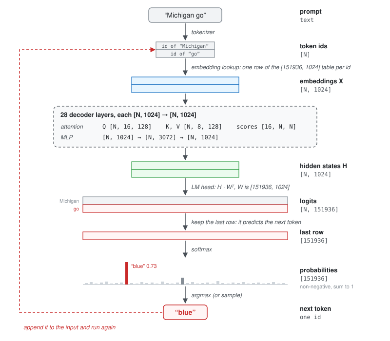
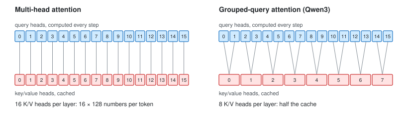
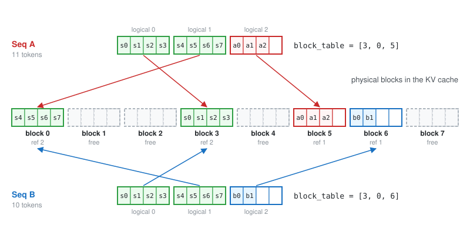
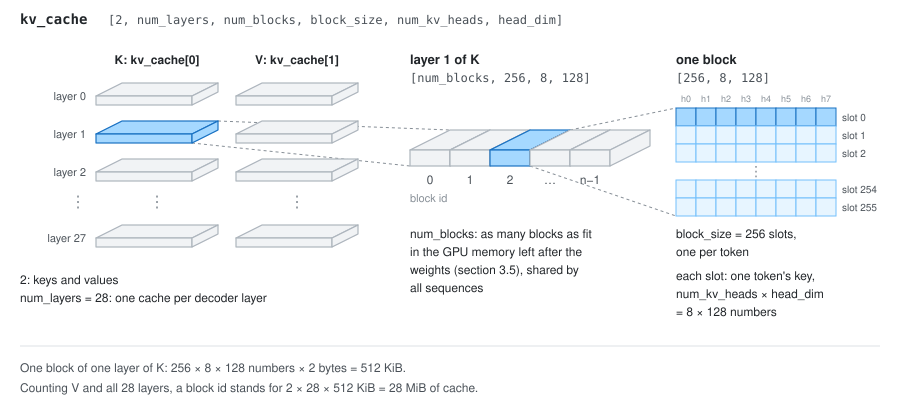
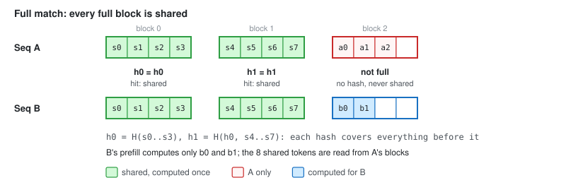

# Nano-vLLM, Block by Block

[The previous post](/blogs/transformer.html) ended where serving an LLM begins: prefill, decode, and a paragraph on the KV cache. This post picks up from there.

[Nano-vLLM](https://github.com/GeeeekExplorer/nano-vllm) is a from-scratch reimplementation of the core of [vLLM](https://github.com/vllm-project/vllm):

- **About 1,200 lines of Python**, small enough to read in an afternoon.
- **Yet as fast as vLLM:** its README reports slightly *higher* throughput on a laptop GPU (1,434 vs 1,362 tokens/s, Qwen3-0.6B on an RTX 4070 Laptop).
- **Read at commit** [`2f21442`](https://github.com/GeeeekExplorer/nano-vllm/tree/2f214426530e2841e7d24c73ee0dfa914d62df56) (November 2025). Every code link below points there.

## Contents
{: .no_toc}

* TOC
{:toc}

## 1. How a Decoder-Only LLM Generates Text

### 1.1 From a prompt to the next token

Nano-vLLM ships one model implementation, [Qwen3][qwen3] (with a flag for Qwen2's QKV biases), and I will use the model from the README's benchmark, Qwen3-0.6B, as the running example. These are the sizes that appear in its tensor shapes ([config](https://huggingface.co/Qwen/Qwen3-0.6B/blob/main/config.json)):

| Symbol | Meaning | Qwen3-0.6B |
|---|---|---|
| $N$ | number of input tokens | 2 in the example below |
| $d$ | model width ($d_{model}$) | 1,024 |
| $n_{\text{vocab}}$ | vocabulary size | 151,936 |
| $L$ | decoder layers | 28 |
| $h_q$, $h_{kv}$ | query heads, key/value heads | 16, 8 |
| $d_k$ | dimension of each head (`head_dim` in code) | 128 |
| $P$ | weights | about 596 million, 1.2 GB in bfloat16 |

Here is what happens to the prompt "Michigan go" on its way to the next token:



Step by step:

1. **Tokenize**, text $\to [N]$: "Michigan go" becomes $N = 2$ token ids.
2. **Embed**, $[N] \to [N, d]$: each id picks one row of the embedding table, $[n_{\text{vocab}}, d]$.
3. **28 decoder layers**, each $[N, d] \to [N, d]$, with two sub-layers:
    - **Causal self-attention.** Each token's query is scored against the keys of itself and the tokens *before* it; the causal mask hides everything after it. The token then takes the weighted mix of those tokens' values. This is the only place where tokens exchange information, and it only flows forward. Shapes: $Q$ is $[N, 16, 128]$, $K$ and $V$ are $[N, 8, 128]$ (two query heads share each key/value head, section 1.4), and the scores are $[16, N, N]$.
    - **MLP**, each token on its own: $[N, 1024] \to [N, 3072] \to [N, 1024]$.
4. **LM head**, $[N, d] \to [N, n_{\text{vocab}}]$: the final hidden states $H$ times $W^\top$, where $W$ is $[n_{\text{vocab}}, d]$ (in Qwen3-0.6B, the embedding table itself). The result is the **logits**, $[2, 151936]$.
5. **Keep the last row**, $[n_{\text{vocab}}]$: the other rows predict tokens we already have.
6. **Softmax**, $[n_{\text{vocab}}] \to [n_{\text{vocab}}]$: probabilities that sum to 1.
7. **Argmax**, $[n_{\text{vocab}}] \to$ one token id: the most likely token.

> **Logits** are raw, unnormalized scores; softmax turns them into probabilities. Row $i$ of the logits is a linear projection of token $i$'s final hidden state, which has causally attended to tokens $1, \dots, i$, so it scores every vocabulary entry as a candidate for token $i + 1$.

Steps 5 to 7 with made-up numbers for five entries of the last row (the real row has 151,936):

| Token | Logit $z$ | Probability $\mathrm{softmax}(z)$ |
|---|---|---|
| blue | 6.0 | **0.734** |
| Blue | 4.5 | 0.164 |
| Wolverines | 3.5 | 0.060 |
| home | 3.0 | 0.037 |
| away | 1.0 | 0.005 |

Argmax picks "blue".

> In practice, engines usually **sample** instead of taking the argmax: they draw the next token at random according to these probabilities, often after dividing the logits by a temperature, so the output is not always the single most likely continuation. Either way, one token comes out, and the generation loop below appends it to the input. Section 3.8 shows Nano-vLLM's sampler.

### 1.2 The generation loop

To generate more than one token, append the new token and run the model again. The obvious loop:

```python
def generate(model, prompt_ids, max_new_tokens):
    ids = list(prompt_ids)
    for _ in range(max_new_tokens):
        logits = model(ids, positions=range(len(ids)))   # [len(ids), vocab]
        next_id = sample(logits[-1])                      # only the last row is used
        ids.append(next_id)
        if next_id == EOS:
            break
    return ids
```

where `sample` is the softmax followed by sampling (or argmax) from section 1.1.

Two things are wasteful here:

- Logits are computed for every position and all but one row is thrown away; that is easy to fix (section 3.8).
- The bigger waste is that step $t$ pushes all $t$ tokens through all 28 layers again.

To see what can be skipped, look at what actually changes between steps.

### 1.3 The KV cache

#### Only the last row is new

Run the loop on "Michigan go". Step 1 pushes the 2 prompt tokens through the model and produces "blue"; step 2 pushes all 3 tokens, "Michigan go blue". In any one layer, the masked attention scores of step 2 are

$$
\begin{array}{r ccc}
 & k_1\ (\text{Michigan}) & k_2\ (\text{go}) & k_3\ (\text{blue}) \\
q_1\ (\text{Michigan}) & q_1 \cdot k_1 & -\infty & -\infty \\
q_2\ (\text{go}) & q_2 \cdot k_1 & q_2 \cdot k_2 & -\infty \\
q_3\ (\text{blue}) & \color{crimson}{q_3 \cdot k_1} & \color{crimson}{q_3 \cdot k_2} & \color{crimson}{q_3 \cdot k_3}
\end{array}
$$

- **The top-left $2 \times 2$ block is exactly step 1's matrix.** The causal mask (previous post, [6.3](/blogs/transformer.html#63-masked-self-attention)) hides column 3 from rows 1 and 2, so their attention weights and outputs come out the same as before.
- **Only the red row is new.** Computing it takes the new query $q_3$ and the keys and values of all three tokens.
- **Two of those three are old:** $k_1, v_1$ and $k_2, v_2$ are the very numbers step 1 already computed.

> So keep them. In **every decoder layer**, all 28 of them, store each token's key and value the first time they are computed. From then on, each step computes $q$, $k$ and $v$ for the newest token only and reads all older keys and values from that layer's store. These per-layer stores are the **KV cache**.

Why this is safe:

- **In every layer, not just one.** By induction over the layers, the hidden state $h_i^{(l)}$ of position $i$ after layer $l$ depends only on tokens $1, \dots, i$. Appending a token never changes an earlier position's hidden state, key or value.
- **Position encoding does not break it.** As the [previous post](/blogs/transformer.html#unfolding-the-formula-michigan-go-blue) showed, each **row** of the positional encoding, one per token, samples sine and cosine waves of different frequencies at that token's own position. Appending a row (a token) leaves the earlier rows (tokens) untouched. Qwen3's RoPE uses the same waves, applied as a rotation of each token's query and key inside every attention layer, and the same argument holds.
- **Keys and values are all that needs keeping.** Each step is always the newest token's query attending, causally, to the keys and values of every token so far. **Older queries and hidden states are never used again.**

#### Prefill and decode

Each decoder layer's attention, with its own cache, becomes:

```python
def attention_with_cache(self, x_new, positions, cache):
    # cache: this layer's own keys and values (one cache per decoder layer)
    q, k, v = self.qkv_proj(x_new)          # only for the new tokens
    q, k = rope(positions, q, k)
    cache.keys.append(k)                    # stored once, read by every later step
    cache.values.append(v)
    K, V = cat(cache.keys), cat(cache.values)
    return causal_attention(q, K, V)        # one output row per new token
```

and generation splits into the two phases from the [previous post](/blogs/transformer.html#decoder-only-prefill-then-decode):

1. **Prefill:** the whole prompt in one parallel pass, which fills the cache of every layer; the last row gives the first new token.
2. **Decode:** one pass per new token, whose input is just the token sampled in the previous step. In every layer, it appends its K and V to that layer's cache and attends over everything cached there so far.

> With a causal mask, position $i$'s hidden state in every layer depends only on tokens $1$ to $i$, so a token's keys and values never change once computed. The KV cache stores them, and each decode step computes only the newest token.

#### What the cache saves

Here is a whole generation, "Michigan go" followed by "blue ! Go blue", with one row per step and one block per token position in that step's input:


Both sides form the same staircase:

- **Without the cache**, every block in it is pushed through all 28 layers, and the red ones only reproduce keys and values the previous step already had.
- **With the cache**, each step computes a single new position, and the green blocks cost only a read of their keys and values.

At realistic lengths the staircase gets large. For a prompt of $p = 1000$ tokens and $g = 1000$ generated tokens:

| | Token positions pushed through the model |
|---|---|
| Without cache | $\sum_{t=0}^{g-1} (p + t) = pg + \tfrac{g(g-1)}{2} \approx 1.5$ million |
| With cache | $p + (g - 1) \approx 2{,}000$ |

- **750 times fewer positions.** Each costs about 2 FLOPs per weight (a multiply and an add), 1.2 GFLOP for Qwen3-0.6B, so about 1.8 PFLOP versus 2.4 TFLOP.
- **Attention improves too.** Without the cache, a step over $T$ tokens computes a $T \times T$ score matrix; with it, one row of $T$ scores. Over the whole generation, attention work grows with the cube of the length without the cache, but only with its square when the cache is used.

### 1.4 How big is the cache?

Per token, the cache holds a key and a value for every layer and every KV head, at 2 bytes per number:

$$
\underbrace{2}_{K,\,V} \times \underbrace{28}_{\text{layers}} \times \underbrace{8}_{\text{KV heads}} \times \underbrace{128}_{\text{head dim}} \times \underbrace{2\ \text{B}}_{\text{bf16}} = 114{,}688\ \text{B} = 112\ \text{KiB per token}
$$

Why 8 KV heads when Qwen3 has 16 query heads?

- **Multi-head attention** gives every query head its own key and value head, so 16 query heads would mean 16 K/V heads in the cache.
- **Grouped-query attention (GQA)**, which Qwen3 uses, splits the 16 query heads into 8 groups of 2, and the two heads in a group attend over the same keys and values.
- **Queries are never cached** (they are computed fresh every step), so GQA halves the cache, 112 KiB per token instead of 224, while the model still looks at the context 16 ways.



Scaling up to a whole workload:

$$
\underbrace{112\ \text{KiB}}_{\text{KV cache per token}} \times \underbrace{4{,}096}_{\text{tokens per sequence}} \times \underbrace{256}_{\text{sequences}} = 112\ \text{GiB}
$$

- **That is the README's benchmark** (256 sequences) if every sequence reached Nano-vLLM's default `max_model_len` of 4,096 tokens.
- **Its sequences actually end at about 1,100 tokens** on average, which still comes to about 30 GiB.
- **The weights are only 1.2 GB.** On the benchmark's 8 GB GPU, once weights and activations are in place, a few gigabytes are left for the cache, enough for a few tens of thousands of tokens.
- **So the sequences cannot all run at once.** Something has to decide which ones run, where their caches live, and what to do when memory runs out.

> For a model this size, the KV cache, not the weights, is what fills the GPU. Serving an LLM is largely a memory-management problem.

### 1.5 Compute-bound or memory-bound?

Section 1.3 counted FLOPs, but FLOPs are only half the story. A GPU can only compute on data it has read from its memory (HBM), and reading is often the slower part. A step that does $F$ FLOPs and reads $M$ bytes takes at least

$$
t \ \ge\ \max\left(\frac{F}{\text{peak FLOP/s}},\ \frac{M}{\text{memory bandwidth}}\right).
$$

Which term wins depends on the step's **arithmetic intensity** $F / M$, the FLOPs it performs per byte it reads:

- **The ridge point** is the GPU's ratio of peak FLOP/s to bandwidth: about $312\ \text{TFLOP/s} \div 2.0\ \text{TB/s} \approx 150$ FLOPs per byte for an NVIDIA A100 (bf16), and $989 \div 3.35 \approx 300$ for an H100.
- **Above it, a step is compute-bound:** the arithmetic units are the bottleneck.
- **Below it, memory-bound:** the arithmetic units sit idle waiting for data.

So a step has to do a few hundred FLOPs for every byte it reads to keep a modern GPU busy. Plotted on log scales, this bound is the **roofline**. Left of the ridge point, the attainable speed rises with intensity (memory bandwidth × FLOPs per byte); right of it, it is capped by peak compute. The dots are the cases worked out below:


Now count both, for the two parts of a forward pass. Two conventions:

- **Multiplying an $[m, k]$ matrix by a $[k, n]$ matrix takes $2mkn$ FLOPs**, because each of the $mn$ outputs is a sum of $k$ products, one multiply and one add each. A GPU executes a multiply-add as one fused instruction (an FMA), but it still counts as 2 FLOPs, and so do the peak figures on GPU spec sheets, so the convention cancels out.
- **Weights and cache are in bfloat16**, 2 bytes per number.

#### Linear layers

A linear layer multiplies the activations of a step's $T$ tokens, $[T, d_{in}]$, by a weight matrix $W$ of shape $[d_{in}, d_{out}]$:

- **FLOPs:** $2T\,d_{in}d_{out}$.
- **Bytes:** it reads $W$ once, $d_{in}d_{out}$ weights at 2 bytes each, so $2\,d_{in}d_{out}$. (It reads the activations too, but they are small next to the weights.)
- **FLOPs per byte:** $T$, whatever the matrix. For example, `qkv_proj` is $[1024, 4096]$, 8.4 MB, and one token through it costs 8.4 MFLOP.
- **The whole model:** summed over all weight matrices, $P \approx 0.6$ billion weights, a step does **$2PT$ FLOPs over $2P$ bytes**.

#### Attention

Attention is where GQA from section 1.4 comes in. Here is the `attention_with_cache` of section 1.3 again, now with heads and shapes. Two numbers set the size of everything:

- **$n$**, the number of new tokens in this step, whose queries are computed.
- **$c$**, the number of tokens in the cache once those new ones are appended: all the tokens of the sequence so far.
- **Prefill** has $c = n$, the prompt length; **decode** has $n = 1$.

*A side note on `rope` in the code below.* The original Transformer [adds sinusoidal positional encodings](/blogs/transformer.html#3-positional-encoding) once, between the embedding and the first decoder block. Qwen3 adds nothing there. It uses RoPE instead, a later technique ([RoFormer](https://arxiv.org/abs/2104.09864), 2021) that rotates $q$ and $k$ inside every attention layer, right after their projections, so that their dot product depends only on the distance between the two tokens.

```python
# one decoder layer. n: new tokens (queries) in this step;
# c: tokens in the cache after appending them. Prefill: c = n. Decode: n = 1.
# d_model: model width; h_q, h_kv: query and KV heads; d_k: dimension of each head
def gqa_attention(x, positions, cache):             # x: [n, d_model]
    q = (x @ W_q).view(n, h_q, d_k)                  # W_q: [d_model, h_q*d_k]
    k = (x @ W_k).view(n, h_kv, d_k)                 # W_k: [d_model, h_kv*d_k]
    v = (x @ W_v).view(n, h_kv, d_k)                 # W_v: [d_model, h_kv*d_k]
    q, k = rope(positions, q, k)
    cache.k.append(k)
    cache.v.append(v)
    K, V = cat(cache.k), cat(cache.v)                # [c, h_kv, d_k] each
    group = h_q // h_kv                              # query heads per KV head
    K = K.repeat_interleave(group, dim=1)            # [c, h_q, d_k]
    V = V.repeat_interleave(group, dim=1)            # [c, h_q, d_k]
    scores = einsum("nhd,chd->hnc", q, K) / sqrt(d_k)          # [h_q, n, c]
    out = einsum("hnc,chd->nhd", causal_softmax(scores), V)    # [n, h_q, d_k]
    return out.reshape(n, h_q * d_k) @ W_o           # W_o: [h_q*d_k, d_model]
```

For Qwen3-0.6B, $d_{model} = 1024$, $h_q = 16$, $h_{kv} = 8$ and $d_k = 128$. Two details:

- **Only the $h_{kv}$ KV heads are cached.** The `repeat_interleave` that lines them up with the query heads happens after reading the cache, and real kernels skip even that: FlashAttention simply has query head $j$ read KV head $\lfloor j \cdot h_{kv} / h_q \rfloor$, here $\lfloor j/2 \rfloor$.
- **$h_q \times d_k$ need not equal $d_{model}$.** Qwen3 chooses $d_k = 128$ on its own, instead of $d_{model} / h_q = 64$, so the 16 query heads together are 2,048 wide, and $W_o$ maps that back to 1,024.

Counting one layer of the code with the $2mkn$ rule:

- **The projections** $W_q$, $W_k$, $W_v$ and $W_o$ are linear layers, already counted above.
- **RoPE, appending to the cache and `repeat_interleave`** are elementwise operations and copies: negligible.
- **The two einsums.** Per head, $[n, d_k] \times [d_k, c]$ for the scores, then $[n, c] \times [c, d_k]$ for the output: $2ncd_k$ FLOPs each. Over $h_q$ heads, that is **$4nc\,h_qd_k$ FLOPs**.
- **Bytes.** The einsums read the cached $K$ and $V$: $2 \times c \times h_{kv} \times d_k$ numbers at 2 bytes, **$4c\,h_{kv}d_k$ bytes**. Over the $L$ layers, that is the 112 KiB per token of section 1.4.

Then the two phases:

- **Prefill**, $c = n$: $4n^2h_qd_k$ FLOPs, of which FlashAttention skips the causally masked half.
- **Decode**, $n = 1$: $4c\,h_qd_k$ FLOPs for $4c\,h_{kv}d_k$ bytes, which is $h_q / h_{kv} = 2$ FLOPs per byte.
- **A batch of $B$ sequences.** A token only ever attends to the earlier tokens of its own sequence, so each sequence reads only its own cache. The batch multiplies the FLOPs and the bytes alike by $B$, and the ratio stays 2.

#### Putting it together

Prefill and decode run the same causal attention: the same `gqa_attention`, with a different $n$. What differs is how often each byte read from memory is reused:

- **In prefill**, $N$ queries share every key and value, so the work grows as $N^2$ while the data grows only as $N$.
- **In decode**, a single query reads all $c$ keys and values and uses each one once. The causal mask does not even do anything: the one new query is the last position and may see every key.
- **The two cases are different enough** that Nano-vLLM calls different FlashAttention kernels for them (section 3.7).

Both parts fit one formula, with:

- **$T$**, the number of tokens a step processes;
- **$P$**, the number of weights in all the model's weight matrices: the attention projections, the MLPs and the LM head. Qwen3-0.6B has about 0.6 billion, so its $2P$ bytes are 1.2 GB;
- **$n$ and $c$**, the new queries and cached tokens of each sequence, as in the code.

$$
\text{linear layers: } \frac{2PT \text{ FLOPs}}{2P \text{ bytes}} = T,
\qquad
\text{attention: } \frac{4nc\,h_qd_k \text{ FLOPs}}{4c\,h_{kv}d_k \text{ bytes}} = n \cdot \frac{h_q}{h_{kv}}
$$

Substituting the two phases, with $h_q / h_{kv} = 2$:

| FLOPs per byte | Linear layers: $T$ | Attention: $n \cdot h_q / h_{kv}$ |
|---|---|---|
| Prefill of $N$ tokens ($T = n = N$) | $N$ | $2N$ (about $N$ once the masked half is skipped) |
| Decode of $B$ sequences ($T = B$, $n = 1$) | $B$ | $2$ |

- **In prefill**, FLOPs per byte grow with the prompt length $N$ in both parts.
- **In decode**, attention is stuck at $h_q / h_{kv}$ however long the context or large the batch.
- **These are idealized counts** that read each weight, key and value once. Prefill applies the LM head only to the last position, and real attention kernels read keys and values a few more times; neither changes the picture.

With Qwen3-0.6B's numbers:

- **Prefill of 1,000 tokens** does about 1,000 FLOPs per byte in the linear layers, and more in attention, far above a ridge point of 150 to 300: **compute-bound**. Only a short prompt, a few dozen tokens, falls below it.
- **The linear layers in decode** do $B$ FLOPs per byte. One sequence does 1 FLOP per byte: **memory-bound**, since every step reads all 1.2 GB of weights to produce a single token. A batch of 64 is still below the ridge, but it gets 64 tokens out of that same weight read, so throughput grows almost linearly with the batch until $B$ approaches the ridge. This is why engines batch decode steps.
- **Attention in decode** does 2 FLOPs per byte whatever $B$ and $c$: **memory-bound, always**, because each sequence reads its own cache and batching shares nothing. At $c = 1000$ that cache is about 110 MiB per sequence per step; for 64 such sequences, almost 7 GiB per step, versus 1.2 GB for the weights. In large-batch decoding, reading the KV cache becomes the main cost. (Without GQA it would be 1 FLOP per byte, and twice the bytes.)

| | Linear layers | Attention |
|---|---|---|
| Prefill | compute-bound, unless the prompt is very short | compute-bound |
| Decode | memory-bound until the batch reaches the ridge (~150 on an A100) | memory-bound, always |

Note the trade the KV cache makes:

- **Without it**, every decode step would be a whole prefill: compute-bound, and enormous.
- **With it**, a decode step does almost no arithmetic, but it has to stream the weights and the cache through the GPU for every token.

> Prefill does about $N$ FLOPs per byte read and is compute-bound. Decode does about $B$ FLOPs per byte in the linear layers and 2 in attention, so it is memory-bound: batching amortizes the weights over many sequences, but every sequence still reads its whole KV cache at every step.

### 1.6 From a KV cache to an inference engine

Each feature of an engine like vLLM answers one of these problems:

| Problem | Idea | Where in Nano-vLLM |
|---|---|---|
| A sequence's final length is unknown; reserving the maximum for each one wastes most of the cache | **Paged KV cache**: fixed-size blocks and a per-sequence block table | [`block_manager.py`][bm], [`attention.py`][attn] |
| Many requests share a prompt prefix (system prompt, few-shot examples, chat history) | **Prefix caching**: find and share blocks by content hash | `BlockManager.allocate` |
| Decode needs large batches, but requests start and finish at different times | **Continuous batching**: rebuild the batch every step; preempt when out of blocks | [`scheduler.py`][sched] |
| Sequences in a batch have different lengths | **Packing**: one flat batch with no padding, and variable-length FlashAttention | `ModelRunner.prepare_prefill` |
| A decode step is hundreds of tiny kernels; the CPU cannot launch them fast enough | **CUDA graphs** | `ModelRunner.capture_cudagraph` |
| The model or its cache does not fit on one GPU | **Tensor parallelism** | [`linear.py`][linear], [`embed_head.py`][embed] |

## 2. Key Concepts

### 2.1 Paged KV cache

Before vLLM, each sequence typically got one contiguous cache tensor of the maximum size, reserved up front rather than grown on demand: 448 MiB for a 4,096-token limit, even if the answer stops at 300 tokens. On a toy cache of 24 token slots:


vLLM's answer, **PagedAttention**, is the one operating systems found decades ago for the same problem: virtual memory with fixed-size pages.

- Split the cache into **blocks** of a fixed number of token slots (Nano-vLLM uses 256).
- Give each sequence a **block table**, listing which physical block holds each of its logical blocks.
- Allocate a new block only when a sequence's last block is full.

A sequence then never wastes more than one partly filled block, and any free block can serve any sequence. Two things to keep apart:

- **A physical block** is a real place in GPU memory: a fixed slice of the one cache tensor that Nano-vLLM allocates on the GPU at startup, identified by its index, the `block_id`.
- **The `Block` objects** in the block manager live on the CPU and only do the bookkeeping: who uses which block, and what it holds.

The analogy with virtual memory is close:

| Virtual memory | Paged KV cache | Nano-vLLM |
|---|---|---|
| Page | Block of 256 token slots | `Block` (CPU-side bookkeeping) |
| Page frame | Physical block: a fixed slice of the cache tensor in GPU memory | `block_id` |
| Page table | Block table | `seq.block_table` |
| Physical address | Slot | `slot_mapping` |
| Free page list | Free block list | `BlockManager.free_block_ids` |
| Shared page | Block shared by sequences with the same prefix | `Block.ref_count` |

Here are two sequences with a block size of 4 (instead of 256, to fit on the page). They share an 8-token system prompt, `s0` to `s7`, which is the subject of the next section:



A token's slot follows from its position $i$ and the block size $S$, just like a physical address from a virtual one:

$$
\mathrm{slot}(i) = \mathtt{block\_table}\big[\lfloor i / S \rfloor\big] \times S + (i \bmod S)
$$

For example, `a2` is at position 10 of Seq A: logical block $\lfloor 10/4 \rfloor = 2$, offset 2, so slot $5 \times 4 + 2 = 22$.

All physical blocks live in one big tensor, `kv_cache`, of shape `[2, num_layers, num_blocks, block_size, num_kv_heads, head_dim]`. Taking it apart from the outside in:

- `2`: keys and values. `kv_cache[0]` is the K cache, `kv_cache[1]` the V cache.
- `num_layers` = 28: every decoder layer has its own cache (section 1.3). Layer $l$'s attention gets the views `kv_cache[0, l]` and `kv_cache[1, l]`.
- `num_blocks`: the pool of physical blocks the block manager hands out. It is not a property of the model; Nano-vLLM computes it at startup from the GPU memory left after loading the weights (section 3.5).
- `block_size` = 256: the token slots in one block, the "page size".
- `num_kv_heads` × `head_dim` = 8 × 128: one token's key (or value) in one layer, 1,024 numbers.



In other words, a block table only fills in the third index of `kv_cache`. For token $i$ of a sequence, in layer $l$:

- **Its key** is `kv_cache[0, l, block_table[i // 256], i % 256]`, an `[8, 128]` slice; **its value** is the same index with `1` in front.
- **The block id and offset are the same** in every layer and for both K and V. So one block table serves all 28 layers, and the bookkeeping never needs to know about layers.
- **A Nano-vLLM block**, 256 tokens across K and V and all 28 layers, is $256 \times 112$ KiB $= 28$ MiB.

The price: a sequence's keys are no longer one contiguous tensor. To read them, attention walks the sequence's block table and gathers `kv_cache[0, l, block_id]` for every block id in it, and `kv_cache[1, l, block_id]` for the values.

> A paged KV cache stores each sequence in fixed-size blocks located through a per-sequence block table, like pages through a page table. Waste is limited to one partly filled block per sequence, and any free block can serve any sequence.

> Finding any cached number takes four answers: key or value (`0` or `1`), which layer (`l`), which block (`block_table[i // 256]`), and where in the block (`i % 256`). Only the third depends on the sequence, and the block table answers it.

### 2.2 Prefix caching

Why share at all:

- **Requests often begin with the same tokens:** a chat service's system prompt, few-shot examples, or a multi-turn conversation that resends its whole history every turn.
- **A shared prefix has the same K and V in every request**, because by section 1.3 the keys and values of a position depend only on the tokens up to that position.
- **So they can be computed once and shared.**

For example, two requests to the same chat service:

```text
request 1:  [system] You are a helpful assistant.  [user] What is a KV cache?
request 2:  [system] You are a helpful assistant.  [user] Why is decode slow?
            |----- same tokens: same K and V ---|
```

Real system prompts often run to hundreds or thousands of tokens, and in a conversation, turn 2 resends all of turn 1 (question and answer) before the new question. All of that prefix can be read from the cache instead of being prefilled again.

The question is how to recognize a block that has been computed before. Nano-vLLM names each full block by a **chained hash**:

$$
h_0 = H(\text{tokens of block } 0), \qquad h_j = H\big(h_{j-1},\ \text{tokens of block } j\big)
$$

When a new sequence arrives, its blocks are hashed in order and looked up. In the paging figure above, Seq A arrived first, and Seq B's first two hashes matched:



- **On a hit**, B's block table points at A's physical block, its reference count goes up, and B's prefill skips those tokens: B computes only `b0` and `b1`.
- **Only full blocks are hashed.** A partly filled last block can still change, so it is never shared.

Why chain the hashes, instead of hashing each block's tokens on its own? Because a block's K and V depend on *all* earlier tokens, not just its own:


- **Block 1 differs**, so $h_1 \ne h_1'$: a miss.
- **Block 2 has identical tokens** in A and C, but different K and V. Even the attention of `x0..x3` to `s0..s3`, the block both sequences share, would be very different, because `s4..s7` ≠ `t4..t7`: the attention weights go through a softmax whose denominator is $\sum_j e^{z_j}$ over *all* earlier tokens. So the hidden states of `x0..x3`, and the K and V that every later layer computes from them, differ. Reusing A's block would be wrong. Since $h_2$ hashes in $h_1$, it differs too: the chain makes $h_j$ a fingerprint of the entire prefix up to the end of block $j$.
- **Reuse stops at the first miss.** Every later block is computed fresh.

Two more details make this work well:

- **Reference counts.** A block returns to the free list only when no sequence uses it.
- **Free blocks keep their contents.** A freed block stays findable through its hash until it is handed out for something else. A later request with the same prefix can bring it back without recomputing, much like a page cache keeps the data of freed pages.

> Prefix caching names each full block by a hash chained over its whole prefix, so requests that start with the same tokens share the same physical blocks and skip their prefill.

### 2.3 Continuous batching and the scheduler

- **Static batching** takes $B$ requests and runs them until the last one finishes. Requests that finish early leave their rows of the batch idle, and new requests wait for the whole batch.
- **Continuous batching** (also called iteration-level scheduling, from the [Orca](https://www.usenix.org/conference/osdi22/presentation/yu) paper) re-forms the batch at every step: finished sequences leave, waiting sequences join.

With six requests and a batch of three rows:


Each **row** is one place in the batch: room for one sequence's token in each step. How can a row change hands halfway through a generation? In training, a batch really is one coherent `[batch, seq_len, d_model]` tensor, pushed through the model together. In decode it is much looser:

- **Each decode step is a fresh forward pass** over one new token per sequence: $B$ rows of $d_{model}$ numbers, one row per sequence.
- **The rows never interact.** Every layer except attention works on each row separately, and attention only reads that sequence's own cache.
- **A sequence's whole history is its KV cache**, kept in its own blocks. Nothing else carries over from one step to the next.

So the scheduler is free to pick a different set of sequences for every step. Section 2.4 goes further and drops the rectangular shape altogether, packing sequences of different lengths into one flat batch.

> In every step, the tokens of all the sequences in the batch go through the same 28 layers, sharing each layer's weights. In each layer $l$, every token writes its key and value into its own sequence's blocks of `kv_cache[0, l]` and `kv_cache[1, l]`, and reads only those.

Nano-vLLM's scheduler decides each step as follows:

1. **Prefill first.** If waiting sequences fit (within a budget of `max_num_batched_tokens = 16384` tokens, at most `max_num_seqs = 512` sequences, and enough free blocks), run a prefill step for as many of them as fit.
2. **Otherwise decode** every running sequence, one token each.
3. **Preempt when out of blocks.** If a running sequence needs a new block and none is free:
    - the most recently admitted running sequence is evicted: it releases all its blocks, and it goes back to the front of the waiting queue;
    - later it is prefilled again, from its prompt plus the tokens it had already generated. This is preemption by **recomputation**;
    - the prefix cache often makes recomputation cheap, if the evicted blocks have not been reused in the meantime.

A schematic run with four requests and a KV cache of only 3 blocks. All sequences draw from that one pool, and each holds as many blocks as its tokens need: one at first, a second once it fills the first.


Note step 4: every Nano-vLLM step is **either all prefill or all decode**, so admitting new sequences pauses the running ones for a step. The two kinds of step have different shapes:

- **A prefill step** has many queries per sequence, a whole prompt each, and is compute-bound (section 1.5).
- **A decode step** has exactly one query per sequence, and is memory-bound.
- **So they take different paths:** different batch preparation, different attention kernels, and CUDA graphs for decode only (section 2.5). Keeping the two apart keeps each path simple.

> The big difference from training is how loose a batch is. A training batch is a fixed set of sequences processed together, start to finish. A decode batch is rebuilt at every step, because each step is **a fresh forward pass over one token per sequence**: sequences join as soon as there is room and leave as soon as they finish, and when blocks run out, the newest is evicted and later recomputed.

### 2.4 Packing variable-length sequences

- **The usual batched tensor** has shape `[batch, max_len]`, padded to the longest sequence, which wastes compute on padding.
- **Nano-vLLM instead concatenates** the tokens of all sequences into one flat vector: the `input_ids` of shape $[N]$ from section 1.1, where $N$ now counts the tokens of every sequence in the batch.
- **Almost every operation** in the model (embedding, linear layers, norms, RoPE, MLP) works on each token row on its own and does not care which sequence a row belongs to.
- **Only attention must respect sequence boundaries.** It gets them as **cumulative sequence lengths**, the input format of FlashAttention's variable-length ("varlen") kernels.

Continuing the paging figure's example, suppose one prefill step admits three sequences:

- **C**: 5 tokens, none cached before this step. Block table `[1, 2]`.
- **B**: 10 tokens, the first 8 (`s0..s7`) found in the prefix cache. Block table `[3, 0, 6]`. Its queries are only its 2 uncached tokens, `b0` and `b1`, but they attend to all 10 of B's tokens.
- **D**: 2 tokens, none cached before this step. Block table `[4]`.

Every token computed in this step, `c0..c4`, `b0`, `b1`, `d0` and `d1`, also has its K and V written into its sequence's blocks, so from the next step on, all of them are cached too.

![Top: the 9 query tokens of the step. Padded into a 3 by 5 tensor, 6 of 15 cells are padding; packed into one row of 9 tokens, there is no padding, and the boundaries 0, 5, 7, 9 go in cu_seqlens_q. Bottom: the attention pattern over the packed batch, a 9 by 17 grid of queries by keys. C's 5 queries attend causally to C's 5 keys; B's 2 queries attend to B's 8 cached keys and its 2 new ones; D's 2 queries attend causally to D's 2 keys; every other cell is masked. The key boundaries 0, 5, 15, 17 go in cu_seqlens_k](/assets/images/posts/nano-vllm/packing.svg)

The model and the attention kernel receive, with the figures' block size of 4:

```text
input_ids    = [c0 c1 c2 c3 c4 | b0 b1 | d0 d1]   9 tokens, no padding
positions    = [ 0  1  2  3  4 |  8  9 |  0  1]
slot_mapping = [ 4  5  6  7  8 | 24 25 | 16 17]   where each new K and V goes
cu_seqlens_q = [0, 5, 7, 9]                       query boundaries
cu_seqlens_k = [0, 5, 15, 17]                     key boundaries, cache included
```


- **`positions`**: each token's position within its own sequence, which RoPE needs.
- **`slot_mapping`**: each new token's slot, from section 2.1's formula, `block_table[pos // 4] * 4 + pos % 4`. B's 8 cached tokens get no slot; their K and V are already there.
- **`cu_seqlens_q` and `cu_seqlens_k` are not pointers, and reserve nothing.** They are running totals of how many queries and keys each sequence has. Sequence $s$'s queries are rows `cu_seqlens_q[s]` to `cu_seqlens_q[s+1]` of the flat batch, and it has `cu_seqlens_k[s+1] - cu_seqlens_k[s]` keys, which its block table locates. So C's queries 0 to 4 attend to C's 5 keys, B's queries 5 and 6 to B's 10 keys (8 of them cached), and D's queries 7 and 8 to D's 2 keys.
- **Nothing is ever missing.** Before a sequence is scheduled, every earlier token's K and V are already in its blocks on the GPU, computed in an earlier step or found in the prefix cache. The new tokens' K and V are written first, and attention runs after.
- **Decode is simpler still.** Each sequence has exactly one query, the token sampled in the previous step, and attends to its whole cache. The kernel only needs each sequence's length and block table.

### 2.5 CUDA graphs

The problem:

- **A small decode step launches many tiny kernels**: about a dozen per layer (projections, norms, RoPE, cache write, attention, MLP), times 28 layers, a few hundred in all.
- **Each launch costs several microseconds** of CPU time in PyTorch and the CUDA driver, so the GPU ends up waiting for the CPU.

The fix:

- **A CUDA graph** records a sequence of kernel launches once and replays it with a single call.
- **The catch: a graph is frozen**, with the same shapes and the same memory addresses every time. So Nano-vLLM records one graph per batch size: 1, 2, 4, 8, then 16, 32, 48, ... up to 512.
- **To run a batch of 13**, it pads to 16, copies the inputs into the fixed buffers that graph was recorded with, and replays.
- **Prefill steps**, whose shapes vary far more, always run normally ("eager").

### 2.6 Tensor parallelism

When a model, or its cache, is too large for one GPU, Nano-vLLM splits every layer across GPUs the way [Megatron-LM](https://arxiv.org/abs/1909.08053) does, arranged so that each attention block and each MLP needs only one communication step. A linear layer $Y = XW$ can be split two ways:

- **Column-parallel**: split $W$ by output columns. Each GPU computes some output features in full, with no communication.
- **Row-parallel**: split $W$ by input rows, with each GPU holding the matching slice of $X$. Each GPU computes a partial sum of the whole output, and an **all-reduce** adds them up:

$$
XW = \begin{bmatrix} X_1 & X_2 \end{bmatrix} \begin{bmatrix} W_1 \\ W_2 \end{bmatrix} = X_1 W_1 + X_2 W_2
$$

Chaining a column-parallel layer into a row-parallel one needs no communication in between, because the column split produces exactly the input slice the row split expects:

| Block | Column-parallel (split outputs) | Local, no communication | Row-parallel (split inputs) + all-reduce |
|---|---|---|---|
| Attention | `qkv_proj`: each GPU gets $16/tp$ query heads and $8/tp$ KV heads | attention, which works head by head | `o_proj` |
| MLP | `gate_up_proj`: each GPU gets a slice of the 3,072 features | SiLU and multiply, elementwise | `down_proj` |

- **Each layer costs two all-reduces**, one after attention and one after the MLP.
- **The KV cache is split too:** each GPU caches only its own KV heads. With 2 GPUs, each stores 4 of the 8, half of the 112 KiB per token.
- **The embedding and the output layer** are split by vocabulary.

## 3. Walking Through the Code

### 3.1 The map

Nano-vLLM splits cleanly into two halves:

- **The CPU side decides.** It picks which sequences run in each step, keeps every sequence's block table, and works out where each new token's K and V will go.
- **The GPU side executes.** It runs the model, writing and reading K and V at exactly the addresses the CPU gave it, and samples the next tokens.
- **They meet once per step:** tensors go to the GPU, token ids come back.

![One step of Nano-vLLM. On the CPU: LLMEngine.step runs the loop, the Scheduler picks the step's sequences, the BlockManager and Sequences hold block tables, ref counts, hashes and the free list, and ModelRunner's prepare functions build input_ids, positions, slot_mapping, cu_seqlens and block tables. These tensors go to the GPU, where the Qwen3 model's attention layers write new K and V into the kv_cache tensor and read K and V through the block tables; the LM head computes logits for the last positions, and the Sampler returns one token id per sequence to the CPU](/assets/images/posts/nano-vllm/architecture.svg)

The files behind each box:

| File | Lines | Role |
|---|---|---|
| [`llm.py`][llm], [`engine/llm_engine.py`][engine] | 5 + 93 | the user-facing API and the step loop |
| [`engine/sequence.py`][seq] | 83 | the state of one request |
| [`engine/scheduler.py`][sched] | 71 | which sequences run in each step |
| [`engine/block_manager.py`][bm] | 112 | paged-cache bookkeeping and prefix caching |
| [`engine/model_runner.py`][runner] | 251 | drives the GPU: cache allocation, batch preparation, CUDA graphs, worker processes |
| [`models/qwen3.py`][qwen3] | 215 | the model |
| [`layers/`](https://github.com/GeeeekExplorer/nano-vllm/tree/2f214426530e2841e7d24c73ee0dfa914d62df56/nanovllm/layers) | 434 | attention, parallel linear layers, RoPE, RMSNorm, embedding and output layer, sampler |
| [`utils/context.py`][context], [`utils/loader.py`][loader] | 27 + 28 | per-step metadata, weight loading |

Usage mirrors vLLM's offline API:

```python
from nanovllm import LLM, SamplingParams

llm = LLM("/YOUR/MODEL/PATH", enforce_eager=True, tensor_parallel_size=1)
sampling_params = SamplingParams(temperature=0.6, max_tokens=256)
outputs = llm.generate(["Hello, Nano-vLLM."], sampling_params)
outputs[0]["text"]
```

and one call to `generate` runs this:

```text
LLM.generate(prompts, sampling_params)
└─ until every sequence is finished: LLMEngine.step()
   ├─ Scheduler.schedule()                    -> (seqs, is_prefill)
   │  └─ BlockManager: allocate / may_append / deallocate
   ├─ ModelRunner.run(seqs, is_prefill)       on every GPU
   │  ├─ prepare_prefill / prepare_decode     -> input_ids, positions, Context
   │  ├─ run_model                            -> eager, or CUDA graph replay
   │  │  └─ Qwen3ForCausalLM
   │  │     └─ 28 x Qwen3DecoderLayer
   │  │        └─ Attention: store_kvcache, then FlashAttention
   │  ├─ compute_logits                       -> last position of each sequence only
   │  └─ Sampler                              -> one token id per sequence
   └─ Scheduler.postprocess(seqs, token_ids)
```

### 3.2 The engine loop

[`generate`][engine] tokenizes every prompt, wraps each in a `Sequence` and adds it to the scheduler's waiting queue. Then it calls [`step`][engine-step] until all sequences are finished:

```python
def step(self):
    seqs, is_prefill = self.scheduler.schedule()
    token_ids = self.model_runner.call("run", seqs, is_prefill)
    self.scheduler.postprocess(seqs, token_ids)
    outputs = [(seq.seq_id, seq.completion_token_ids) for seq in seqs if seq.is_finished]
    num_tokens = sum(len(seq) for seq in seqs) if is_prefill else -len(seqs)
    return outputs, num_tokens
```

Each step does three things:

1. **Schedule.** The scheduler picks a set of sequences, and whether this step prefills them or decodes them.
2. **Run.** The model runner does one forward pass over their tokens. A decoding sequence is guaranteed to find all its earlier K and V in the cache.
3. **Postprocess.** Each sampled token is appended to its sequence, and finished sequences are retired.

> **Takeaway**
>
> - **The CPU decides everything:** which sequences run, whether the step is a prefill or a decode, and that every decoding sequence's K and V are already in the cache. **The GPU does two things:** it runs the forward pass, and it holds the KV cache.

### 3.3 The scheduler

The scheduler's whole state is two queues, and a sequence's `status` says which one it is in:

- **`waiting`** holds sequences with no K and V in the cache yet: new requests, and preempted ones that lost their blocks. Before they can generate anything, they need a **prefill**, which computes K and V for all their tokens.
- **`running`** holds sequences whose K and V are already in their blocks. They only need **decode** steps, one token at a time.
- **Finished** sequences leave both queues, and their blocks are released.


[`Scheduler.schedule`][sched-schedule] implements section 2.3 almost line by line (the comments are mine):

```python
def schedule(self) -> tuple[list[Sequence], bool]:
    # prefill: admit waiting sequences, first come, first served
    scheduled_seqs = []
    num_seqs = 0
    num_batched_tokens = 0
    while self.waiting and num_seqs < self.max_num_seqs:
        seq = self.waiting[0]
        # stop at the first one that does not fit: never skip ahead to a smaller one.
        # Both checks are cautious and count all of seq's tokens and blocks,
        # because cache hits are only known after allocate
        if (num_batched_tokens + len(seq) > self.max_num_batched_tokens
                or not self.block_manager.can_allocate(seq)):
            break
        num_seqs += 1
        # allocate checks the prefix cache: hits reuse existing blocks and raise
        # seq.num_cached_tokens; only misses take fresh blocks (section 3.4)
        self.block_manager.allocate(seq)
        num_batched_tokens += len(seq) - seq.num_cached_tokens   # uncached only
        seq.status = SequenceStatus.RUNNING
        self.waiting.popleft()
        self.running.append(seq)
        scheduled_seqs.append(seq)
    if scheduled_seqs:
        return scheduled_seqs, True                     # prefill takes priority

    # decode: one token for every running sequence
    while self.running and num_seqs < self.max_num_seqs:
        seq = self.running.popleft()
        # seq needs a free block if its new token starts one (can_append).
        # Until one is free, evict other running sequences, newest first.
        # self.running now holds only the sequences not yet scheduled in this
        # step, so the ones already scheduled are safe
        while not self.block_manager.can_append(seq):
            if self.running:
                # evict the newest running sequence: it loses its blocks
                # and goes back to the front of waiting
                self.preempt(self.running.pop())
            else:
                # no one else left to evict: seq gives up its own blocks and
                # waits too. Still a decode step, just without seq
                self.preempt(seq)
                break
        # while-else: runs only if the loop above ended without a break,
        # that is, if seq got its block (or did not need one)
        else:
            num_seqs += 1
            self.block_manager.may_append(seq)
            scheduled_seqs.append(seq)
    assert scheduled_seqs
    self.running.extendleft(reversed(scheduled_seqs))   # back to the front, in order
    return scheduled_seqs, False
```

All of the preemption happens inside a decode step:

- **Every victim is a running sequence** whose K and V were computed in earlier steps. Preempting it throws that cache away, and it is prefilled again later.
- **Even `self.preempt(seq)` is not a prefill.** When no other sequence is left to evict, `seq` itself steps aside, and the decode step goes on without it.

Two small helpers complete the scheduler:

- **[`preempt`][sched-preempt] acts on a whole sequence.** Through [`deallocate`][bm-deallocate], it drops the sequence's reference to each of its blocks; a block is actually freed only when its reference count reaches zero, since a shared prefix block may still be used by others. Then it clears the sequence's block table and puts the sequence at the *front* of the waiting queue, so it is the first to be prefilled again.
- **[`postprocess`][sched-postprocess]** appends each sampled token. A sequence that produced `<eos>` (unless `ignore_eos` is set) or reached `max_tokens` is marked finished, and its blocks are released the same way, ready for the next prefill.

> **Takeaways**
>
> - **Prefill is prioritized over decode.** If any waiting sequence fits, the step is a prefill step; decode runs only when nothing can be admitted.
> - **A step is all prefill or all decode**, never a mix.
> - **Admission is first come, first served**, limited by the token budget, the number of sequences and the free blocks.
> - **When blocks run out, the newest sequence is evicted** and later recomputed, so the oldest sequences keep their caches and finish first.

### 3.4 The block manager

The [`BlockManager`][bm] keeps:

- **a fixed array of `Block`s**, each with a `ref_count`, a `hash` (`-1` when it has none) and a copy of its `token_ids`;
- **the free list**, a `deque` of block ids, and the set of used ids;
- **the prefix-cache index** `hash_to_block_id`.

The hash is [xxHash64](https://github.com/Cyan4973/xxHash) over the previous block's hash and this block's token ids:

```python
@classmethod
def compute_hash(cls, token_ids: list[int], prefix: int = -1):
    h = xxhash.xxh64()
    if prefix != -1:
        h.update(prefix.to_bytes(8, "little"))
    h.update(np.array(token_ids).tobytes())
    return h.intdigest()
```

#### Allocating a new sequence, with prefix caching

[`allocate`][bm-allocate] is called once per sequence, when it is admitted to prefill. It walks the sequence's blocks in order, looking each one up in the prefix cache, until the first miss:

- **A hit saves an allocation:** the sequence just points at the existing block and bumps its reference count.
- **A miss takes a fresh block** from the free list, and so does every block after it.
- **Only a full block can hit.** A partly filled last block is never hashed.

The code, with my comments:

```python
def allocate(self, seq: Sequence):
    assert not seq.block_table
    h = -1
    cache_miss = False
    for i in range(seq.num_blocks):
        token_ids = seq.block(i)
        # only a full block gets a (chained) hash; a partial last block gets -1,
        # which is never in the index, so it always misses
        h = self.compute_hash(token_ids, h) if len(token_ids) == self.block_size else -1
        block_id = self.hash_to_block_id.get(h, -1)
        # a hit must also match the stored tokens: this catches hash collisions,
        # and stale entries left behind when a freed block was reused
        if block_id == -1 or self.blocks[block_id].token_ids != token_ids:
            # sticky: hits last until the first mismatch, and every block after
            # that is a miss too
            cache_miss = True
        if cache_miss:
            block_id = self.free_block_ids[0]           # take a fresh block
            block = self._allocate_block(block_id)
        else:
            seq.num_cached_tokens += self.block_size    # prepare_prefill skips these
            if block_id in self.used_block_ids:
                # in use by another sequence: share it
                block = self.blocks[block_id]
                block.ref_count += 1
            else:
                # a freed block: its sequence finished, but its K and V are still
                # there, so take it back off the free list
                block = self._allocate_block(block_id)
        if h != -1:
            block.update(h, token_ids)                  # register it in the index
            self.hash_to_block_id[h] = block_id
        seq.block_table.append(block_id)
```

Two more subtleties:

- **The block manager never touches GPU memory.** It is pure CPU bookkeeping: block ids, reference counts, hashes and a free list, which decide how the big `kv_cache` tensor on the GPU gets used. Allocating a block only hands out an id; the K and V arrive later, when the model writes them.
- **A block's hash is registered before its K and V exist**, at allocation time. That is safe even if a second sequence in the same prefill batch hits it, because in each layer the attention module first writes the K and V of the whole batch into the cache and only then runs attention (section 3.7).

#### Growing a sequence during decode

Each decode step adds one token, so [`may_append`][bm-may-append] only has to look at where that token falls within its block (`len(seq)` already counts it). The scheduler calls it only after `can_append` has said yes, evicting other sequences if it had to (section 3.3), so whenever a new block is needed, a free one is guaranteed. Its if/elif/else is the whole story:

- **The token starts a new block:** take a fresh block from the free list and push its id onto the sequence's block table.
- **The token fills the last block:** the block is now full, so hash it (chained to the previous block) and register it in the prefix-cache index, where later sequences can hit it. Generated text can be shared this way too, for example by the next turn of a conversation.
- **Anywhere else:** nothing to do. The token simply goes into the current block, with no cache bookkeeping at all.

```python
def may_append(self, seq: Sequence):          # asserts left out
    block_table = seq.block_table
    last_block = self.blocks[block_table[-1]]
    if len(seq) % self.block_size == 1:        # starts a new block
        block_id = self.free_block_ids[0]
        self._allocate_block(block_id)
        block_table.append(block_id)
    elif len(seq) % self.block_size == 0:      # fills the last block: hash it
        token_ids = seq.block(seq.num_blocks-1)
        prefix = self.blocks[block_table[-2]].hash if len(block_table) > 1 else -1
        h = self.compute_hash(token_ids, prefix)
        last_block.update(h, token_ids)
        self.hash_to_block_id[h] = last_block.block_id
    else:                                      # in the middle: nothing to do
        pass
```

- **[`can_append`][bm-can-append]** needs a free block only in the first case. The original is a terse one-liner, `return len(self.free_block_ids) >= (len(seq) % self.block_size == 1)`, which compares a count with a bool (0 or 1). Spelled out:

```python
def can_append(self, seq: Sequence) -> bool:
    starts_new_block = len(seq) % self.block_size == 1   # the new token opens a block
    return not starts_new_block or len(self.free_block_ids) > 0
```

> **Takeaways**
>
> - **Prefix caching happens at allocation time.** A new sequence's full blocks are hashed in order, and every hit reuses a physical block and skips 256 tokens of prefill.
> - **A hit is double-checked** against the stored tokens, and reuse stops at the first miss.
> - **It is all CPU bookkeeping:** block ids, reference counts, hashes and a free list that decide how the GPU's `kv_cache` tensor is used. Freed blocks stay findable until they are reused.
> - **During decode, a sequence needs a new block only when its newest token starts one**, and a block that fills up is hashed, so generated text can be shared too.

### 3.5 Starting the GPU side

The [`ModelRunner`][runner] constructor does everything once, in this order:

1. join the NCCL process group;
2. build the model in bfloat16, directly on the GPU;
3. load the weights;
4. run a warmup pass;
5. allocate the KV cache with whatever memory is left;
6. record the CUDA graphs.

#### Loading weights into fused layers

- **A Hugging Face checkpoint** stores `q_proj`, `k_proj` and `v_proj` separately, and `gate_proj` and `up_proj` separately.
- **Nano-vLLM fuses each group** into one matrix, `qkv_proj` and `gate_up_proj`.
- **Why fuse?** One large matrix multiplication instead of three (or two) small ones:
    - **the input is read once**, not once per matrix;
    - **one kernel launch instead of three**, which matters in decode, where kernels are tiny and launches add up (section 2.5);
    - **a bigger product keeps the GPU busier** than several small ones that each underfill it.
- **Fusing does not mix the parameters.** The three matrices are placed side by side along the output dimension, $[1024, 2048]$, $[1024, 1024]$ and $[1024, 1024]$ into one $[1024, 4096]$ matrix, and one multiplication computes all three products at once:

$$
x \,\big[\, W_q \;\big|\; W_k \;\big|\; W_v \,\big] = \big[\, xW_q \;\big|\; xW_k \;\big|\; xW_v \,\big]
$$

The output is then split back into $q$, $k$ and $v$. `gate_proj` and `up_proj` are fused the same way. The model declares which checkpoint tensor goes into which slice:

```python
packed_modules_mapping = {
    "q_proj": ("qkv_proj", "q"),
    "k_proj": ("qkv_proj", "k"),
    "v_proj": ("qkv_proj", "v"),
    "gate_proj": ("gate_up_proj", 0),
    "up_proj": ("gate_up_proj", 1),
}
```

and the [loader][loader] passes each checkpoint tensor to its parameter's `weight_loader` together with the shard id, which copies it into the right slice (and, with tensor parallelism, takes only this GPU's part).

#### Sizing the cache

1. **Measure the activations.** [`warmup_model`][runner-warmup] runs the largest prefill the scheduler will ever submit, 4 dummy sequences of 4,096 tokens, only to measure how much memory activations need at their peak.
2. **Give the cache everything that is left.** [`allocate_kv_cache`][runner-alloc] computes

    $$
    \mathtt{num\_blocks} = \frac{0.9 \times \text{total} - \text{used} - (\text{peak} - \text{current})}{28\ \text{MiB per block}}
    $$

    where `used` is everything already on the GPU (the CUDA context, the weights), and `peak - current` is the activations' peak, which must stay free for later prefills.
3. **Allocate the big tensor once.** The result is the `kv_cache` tensor of section 2.1, `[2, 28, num_blocks, 256, 8, 128]`, and each attention layer gets its views `kv_cache[0, l]` and `kv_cache[1, l]`.

> **Takeaway**
>
> - **Everything that can be done once is done at startup:** fused weights, a worst-case warmup, the KV cache, the CUDA graphs.

### 3.6 Turning a batch into tensors

By the time the GPU side runs, the CPU side has done its part: the scheduler has chosen this step's sequences and whether to prefill or decode them, and the block manager has given each one a block table (and, for a prefill, found its cached prefix). [`ModelRunner.run`][runner-run] does the rest:

```python
def run(self, seqs: list[Sequence], is_prefill: bool) -> list[int]:
    input_ids, positions = (self.prepare_prefill(seqs) if is_prefill
                            else self.prepare_decode(seqs))
    temperatures = self.prepare_sample(seqs) if self.rank == 0 else None
    logits = self.run_model(input_ids, positions, is_prefill)
    token_ids = self.sampler(logits, temperatures).tolist() if self.rank == 0 else None
    reset_context()
    return token_ids
```

1. **Prepare.** `prepare_prefill` or `prepare_decode` turns the sequences into the model's two inputs, `input_ids` and `positions`, and puts everything else into the `Context`.
2. **Run.** `run_model` runs the model, eagerly or by replaying a CUDA graph (section 3.9).
3. **Sample.** The sampler picks one token per sequence (section 3.8), and the `Context` is cleared.

#### The Context: metadata on the side

- **The model's `forward` takes only `input_ids` and `positions`**, like any PyTorch model.
- **Everything else** (`is_prefill`, `cu_seqlens_q/k`, `slot_mapping`, `context_lens`, `block_tables`) goes into a module-level [`Context`][context] via `set_context`. The attention layers and the output layer read it with `get_context()`.
- **Why not pass it down?** Threading these arguments through `Qwen3ForCausalLM`, `Qwen3Model`, every `Qwen3DecoderLayer` and `Qwen3Attention` down to `Attention` would clutter every signature for the sake of two consumers. vLLM uses the same pattern, which it calls the forward context.
- **It also matters for CUDA graphs** (section 3.9).

#### Prefill

[`prepare_prefill`][runner-prefill] packs the chosen sequences into the flat batch of section 2.4. For each sequence it emits only the uncached tokens, their positions and the slots for their K and V, plus `cu_seqlens_q` and `cu_seqlens_k`, which only track where each sequence's queries and keys begin and end:

```python
for seq in seqs:
    seqlen = len(seq)
    input_ids.extend(seq[seq.num_cached_tokens:])
    positions.extend(list(range(seq.num_cached_tokens, seqlen)))
    seqlen_q = seqlen - seq.num_cached_tokens
    seqlen_k = seqlen
    cu_seqlens_q.append(cu_seqlens_q[-1] + seqlen_q)
    cu_seqlens_k.append(cu_seqlens_k[-1] + seqlen_k)
    ...
    for i in range(seq.num_cached_blocks, seq.num_blocks):
        start = seq.block_table[i] * self.block_size
        if i != seq.num_blocks - 1:
            end = start + self.block_size
        else:
            end = start + seq.last_block_num_tokens
        slot_mapping.extend(list(range(start, end)))
if cu_seqlens_k[-1] > cu_seqlens_q[-1]:    # prefix cache
    block_tables = self.prepare_block_tables(seqs)
```

- **The slots are simple ranges.** Cached tokens always come in whole blocks, so the first uncached token is always at the start of block `num_cached_blocks`.
- **Block tables** (padded with `-1` to equal length) are only needed when some sequence has cached tokens; otherwise attention can use the freshly computed K and V directly.

#### Decode

[`prepare_decode`][runner-decode] is shorter, one token per sequence:

```python
for seq in seqs:
    input_ids.append(seq.last_token)
    positions.append(len(seq) - 1)
    context_lens.append(len(seq))
    slot_mapping.append(seq.block_table[-1] * self.block_size + seq.last_block_num_tokens  - 1)
```

- **The slot is the address of the last token:** the last block, at offset `last_block_num_tokens - 1`.
- **Every list becomes a tensor** via pinned memory and `.cuda(non_blocking=True)`, so the copies to the GPU do not block the CPU.

> **Takeaways**
>
> - **Prefill sends only uncached tokens**, and their slots are simple ranges, because cached tokens always come in whole blocks.
> - **Decode sends one token per sequence**, its last one, written at its last slot.
> - **Batch metadata travels in a global `Context`**, so the model keeps a plain `forward(input_ids, positions)`.

### 3.7 Inside attention: writing and reading the cache

The model itself is a standard Qwen3. What makes it an inference engine is one module: every decoder layer's attention ends in a call to the generic [`Attention`][attn] module, with that layer's `q`, `k` and `v` for the new tokens. This is where the KV cache is written and read:

```python
def forward(self, q, k, v):
    context = get_context()
    k_cache, v_cache = self.k_cache, self.v_cache
    if k_cache.numel() and v_cache.numel():
        store_kvcache(k, v, k_cache, v_cache, context.slot_mapping)
    if context.is_prefill:
        if context.block_tables is not None:    # prefix cache
            k, v = k_cache, v_cache
        o = flash_attn_varlen_func(q, k, v,
                                   max_seqlen_q=context.max_seqlen_q, cu_seqlens_q=context.cu_seqlens_q,
                                   max_seqlen_k=context.max_seqlen_k, cu_seqlens_k=context.cu_seqlens_k,
                                   softmax_scale=self.scale, causal=True, block_table=context.block_tables)
    else:    # decode
        o = flash_attn_with_kvcache(q.unsqueeze(1), k_cache, v_cache,
                                    cache_seqlens=context.context_lens, block_table=context.block_tables,
                                    softmax_scale=self.scale, causal=True)
    return o
```

- **First, write:** the new tokens' K and V go to their slots. The `numel()` check skips this during warmup, which runs before the cache exists.
- **Then read**, in one of three ways:

| Phase | Queries | Keys and values read from | Call |
|---|---|---|---|
| Prefill, no cached prefix | all new tokens | the freshly computed `k`, `v` | `flash_attn_varlen_func` |
| Prefill with cached prefix | uncached tokens only | the paged cache, via `block_table` | `flash_attn_varlen_func(..., block_table=...)` |
| Decode | one per sequence | the paged cache, via `block_table` and `cache_seqlens` | `flash_attn_with_kvcache` |

Two things make `causal=True` correct here:

- **The mask is aligned to the bottom right.** When there are fewer queries than keys, FlashAttention (since version 2.1) aligns the causal mask to the bottom right of the score matrix, so the last query sees every key. That is exactly right for new tokens that follow a cached prefix.
- **GQA is handled inside the kernel:** 16 query heads read from 8 KV heads, and the cache only ever stores 8.

The write is a small [Triton](https://triton-lang.org/) kernel:

```python
@triton.jit
def store_kvcache_kernel(key_ptr, key_stride, value_ptr, value_stride,
                         k_cache_ptr, v_cache_ptr, slot_mapping_ptr, D: tl.constexpr):
    idx = tl.program_id(0)
    slot = tl.load(slot_mapping_ptr + idx)
    if slot == -1: return
    key_offsets = idx * key_stride + tl.arange(0, D)
    value_offsets = idx * value_stride + tl.arange(0, D)
    key = tl.load(key_ptr + key_offsets)
    value = tl.load(value_ptr + value_offsets)
    cache_offsets = slot * D + tl.arange(0, D)
    tl.store(k_cache_ptr + cache_offsets, key)
    tl.store(v_cache_ptr + cache_offsets, value)
```

- **One program per new token**, each copying $D = 8 \times 128 = 1024$ values of K and of V to `slot * D`.
- **That flat offset works** because a layer's cache, `[num_blocks, block_size, 8, 128]`, is contiguous: it is also an array of `num_blocks * block_size` rows of $D$ values each, and the slot is the row index.
- **Slot `-1` means "write nothing"**, which section 3.9 relies on.
- **The row strides are passed in** rather than assumed, because `v` is still a view into the fused QKV output, so its rows are 4,096 values apart, not 1,024. Passing the stride avoids a copy.

> **Takeaways**
>
> - **Every attention layer writes before it reads:** a small Triton kernel stores the new K and V at their slots, then FlashAttention runs.
> - **There are three read paths:** fresh K and V for a plain prefill, the paged cache for a prefill with a cached prefix, and the paged cache with one query per sequence for decode.

### 3.8 Logits and sampling

#### Only the last position

The model's forward pass returns one hidden state per packed token, $[N, 1024]$. The LM head projects hidden states onto the vocabulary, $[1024] \to [151936]$, and only one row per sequence is needed to sample its next token: the last one. So [`ParallelLMHead.forward`][embed-lmhead] picks those rows *before* the projection:

```python
def forward(self, x: torch.Tensor):              # x: [N, 1024], every packed token
    context = get_context()
    if context.is_prefill:
        last_indices = context.cu_seqlens_q[1:] - 1   # each sequence's last row
        x = x[last_indices].contiguous()          # [num_seqs, 1024]
    logits = F.linear(x, self.weight)             # [num_seqs, 151936]
    ...
```

- **`cu_seqlens_q[1:] - 1`** is the row just before each next sequence starts, which is each sequence's last row. In the example of section 2.4, `cu_seqlens_q = [0, 5, 7, 9]`, so the rows are `[4, 6, 8]`: `c4`, `b1` and `d1`.
- **Logits are still computed, just only for those rows:** $[3, 151936]$ instead of $[9, 151936]$. For a full 16,384-token prefill, all the rows would take $16384 \times 151936 \times 2$ bytes, about 5 GB, more than the 8 GB GPU could spare.
- **Decode needs no selection:** every sequence already has exactly one row.

#### Sampling

The [`Sampler`][sampler] turns each row of logits into a token:

- **The usual temperature softmax**, with one temperature per sequence.
- **A sample without `torch.multinomial`:** it divides the probabilities by random noise drawn from $\mathrm{Exp}(1)$ and takes the argmax. This picks each token with exactly its probability (it is the Gumbel-max trick in another form), using only elementwise operations and one `argmax`, which `torch.compile` fuses into a kernel or two.

> **Takeaways**
>
> - **Logits are computed only for each sequence's last position**: the rows are picked before the projection, and for a full prefill, all of them would not even fit in memory.
> - **Sampling is one fused kernel**, with a temperature per sequence.

### 3.9 CUDA graphs

[`capture_cudagraph`][runner-capture] allocates input and output buffers at the maximum batch size, then records one graph per batch size, largest first:

```python
self.graph_bs = [1, 2, 4, 8] + list(range(16, max_bs + 1, 16))
for bs in reversed(self.graph_bs):
    graph = torch.cuda.CUDAGraph()
    set_context(False, slot_mapping=slot_mapping[:bs], context_lens=context_lens[:bs], block_tables=block_tables[:bs])
    outputs[:bs] = self.model(input_ids[:bs], positions[:bs])    # warmup
    with torch.cuda.graph(graph, self.graph_pool):
        outputs[:bs] = self.model(input_ids[:bs], positions[:bs])    # capture
    if self.graph_pool is None:
        self.graph_pool = graph.pool()
    self.graphs[bs] = graph
    torch.cuda.synchronize()
    reset_context()
```

- **All graphs share one memory pool.** They never run at the same time, so they can reuse the same memory for their intermediate tensors, and recording the largest graph first means the smaller ones fit in memory already reserved.
- **The `Context` set during capture points at slices of the fixed buffers.** A recorded kernel remembers addresses, not Python objects, so every replay reads whatever those buffers hold at that moment.
- **This is the other reason for the `Context` design:** the model code is the same whether it runs eagerly or inside a graph.

[`run_model`][runner-run-model] replays:

```python
if is_prefill or self.enforce_eager or input_ids.size(0) > 512:
    return self.model.compute_logits(self.model(input_ids, positions))
else:
    bs = input_ids.size(0)
    context = get_context()
    graph = self.graphs[next(x for x in self.graph_bs if x >= bs)]
    graph_vars = self.graph_vars
    graph_vars["input_ids"][:bs] = input_ids
    graph_vars["positions"][:bs] = positions
    graph_vars["slot_mapping"].fill_(-1)
    graph_vars["slot_mapping"][:bs] = context.slot_mapping
    graph_vars["context_lens"].zero_()
    graph_vars["context_lens"][:bs] = context.context_lens
    graph_vars["block_tables"][:bs, :context.block_tables.size(1)] = context.block_tables
    graph.replay()
    return self.model.compute_logits(graph_vars["outputs"][:bs])
```

- **It picks the smallest recorded size that fits**, and copies the real inputs into the buffers.
- **It makes the padding rows harmless:** slot `-1` makes `store_kvcache` skip them, and a context length of 0 gives them nothing to attend to.
- **The output layer runs outside the graph**, on the real rows only.

> **Takeaways**
>
> - **Decode steps replay a recorded graph** for the next batch size up; prefill always runs eagerly.
> - **Inputs are copied into fixed buffers**, and padding rows are made harmless with slot `-1` and a context length of 0.
> - **The `Context` points at those buffers**, which is what lets the same model code run eagerly or inside a graph.

### 3.10 Tensor parallelism in code

The splitting of section 2.6 lives in [`linear.py`][linear]. Each class's `weight_loader` copies only this GPU's part of a checkpoint tensor, along dimension 0 (outputs) for column-parallel layers and dimension 1 (inputs) for row-parallel ones. Only the row-parallel layer communicates:

```python
class RowParallelLinear(LinearBase):
    def forward(self, x: torch.Tensor) -> torch.Tensor:
        y = F.linear(x, self.weight, self.bias if self.tp_rank == 0 else None)
        if self.tp_size > 1:
            dist.all_reduce(y)
        return y
```

- **The bias is added by rank 0 only**; otherwise the all-reduce would add it $tp$ times.
- **[`VocabParallelEmbedding`][embed]** gives each GPU a slice of the vocabulary. A GPU looks up the tokens in its slice, writes zeros for the others, and an all-reduce sums the parts.
- **`ParallelLMHead`** computes logits for its vocabulary slice, and rank 0 gathers and concatenates them, since only rank 0 samples.

That leaves the control plane: how do the other GPUs know what to run? `LLMEngine` starts one process per extra GPU, each running `ModelRunner(config, rank, event)`, which after its setup enters [`loop`][runner-loop] and waits. Rank 0 does not send tensors; it sends the *method call*, through a 1 MiB shared memory segment:

```python
def write_shm(self, method_name, *args):       # rank 0
    data = pickle.dumps([method_name, *args])
    n = len(data)
    self.shm.buf[0:4] = n.to_bytes(4, "little")
    self.shm.buf[4:n+4] = data
    for event in self.event:
        event.set()

def read_shm(self):                             # ranks 1 .. tp-1
    self.event.wait()
    n = int.from_bytes(self.shm.buf[0:4], "little")
    method_name, *args = pickle.loads(self.shm.buf[4:n+4])
    self.event.clear()
    return method_name, args
```

- **Every GPU runs the same `run(seqs, is_prefill)`** on the same sequences, builds the same input tensors, and meets the others in NCCL collectives inside the model.
- **To keep the message small**, [`Sequence.__getstate__`][seq-getstate] sends the full token list only before a sequence has generated anything. After that it sends just `last_token`, since the history already lives in every GPU's KV cache.

> **Takeaways**
>
> - **Each GPU loads only its slice of every weight**, and only the row-parallel layers and the vocabulary-split embedding communicate, with one all-reduce each.
> - **Rank 0 drives the other GPUs by sending method calls, not tensors**, through shared memory; then every GPU runs the same step on its own slice.

## 4. Epilogue

Nano-vLLM leaves out much of what makes vLLM a production system:

- **Serving:** an HTTP server and streaming.
- **Scheduling:** chunked prefill, and swapping preempted sequences to CPU memory.
- **Speed and size:** speculative decoding, quantization, LoRA adapters.
- **Sampling:** top-k and top-p.
- **Scale and breadth:** pipeline and expert parallelism, and hundreds of other model architectures.

What it keeps is the core loop, and the core loop is the part worth understanding:

- **Generation is a loop of forward passes**, and the causal mask means earlier positions never change, so their keys and values are computed once and cached.
- **The cache dominates memory**, so the cache is managed like virtual memory: fixed-size blocks, block tables, slots, reference counts, and a free list that doubles as a prefix cache.
- **Decode is memory-bound**, so throughput comes from batching, and a scheduler keeps the batch full by rebuilding it every step and preempting when blocks run out.
- **Everything else removes overhead**: packing instead of padding, logits only for the last position, fused kernels, and CUDA graphs that turn a few hundred kernel launches into one.

## 5. References

1. Xingkai Yu, [Nano-vLLM](https://github.com/GeeeekExplorer/nano-vllm), read at commit [`2f21442`](https://github.com/GeeeekExplorer/nano-vllm/tree/2f214426530e2841e7d24c73ee0dfa914d62df56). Code excerpts are from this repository (MIT License).
2. W. Kwon et al., [Efficient Memory Management for Large Language Model Serving with PagedAttention](https://arxiv.org/abs/2309.06180), SOSP 2023. The vLLM paper.
3. G.-I. Yu et al., [Orca: A Distributed Serving System for Transformer-Based Generative Models](https://www.usenix.org/conference/osdi22/presentation/yu), OSDI 2022. Iteration-level scheduling.
4. T. Dao, [FlashAttention-2: Faster Attention with Better Parallelism and Work Partitioning](https://arxiv.org/abs/2307.08691), 2023, and the [flash-attention](https://github.com/Dao-AILab/flash-attention) repository, which documents the varlen and paged KV cache interfaces.
5. M. Shoeybi et al., [Megatron-LM: Training Multi-Billion Parameter Language Models Using Model Parallelism](https://arxiv.org/abs/1909.08053), 2019.
6. J. Su et al., [RoFormer: Enhanced Transformer with Rotary Position Embedding](https://arxiv.org/abs/2104.09864), 2021.
7. J. Ainslie et al., [GQA: Training Generalized Multi-Query Transformer Models from Multi-Head Checkpoints](https://arxiv.org/abs/2305.13245), EMNLP 2023.
8. Qwen Team, [Qwen3 Technical Report](https://arxiv.org/abs/2505.09388), 2025, and the [Qwen3-0.6B model card](https://huggingface.co/Qwen/Qwen3-0.6B).
9. PyTorch documentation, [CUDA Graphs](https://pytorch.org/docs/stable/notes/cuda.html#cuda-graphs).
10. [vLLM](https://github.com/vllm-project/vllm) source code.
11. My previous post, [The Transformer, Piece by Piece](/blogs/transformer.html).

[llm]: https://github.com/GeeeekExplorer/nano-vllm/blob/2f214426530e2841e7d24c73ee0dfa914d62df56/nanovllm/llm.py
[engine]: https://github.com/GeeeekExplorer/nano-vllm/blob/2f214426530e2841e7d24c73ee0dfa914d62df56/nanovllm/engine/llm_engine.py#L59-L93
[engine-step]: https://github.com/GeeeekExplorer/nano-vllm/blob/2f214426530e2841e7d24c73ee0dfa914d62df56/nanovllm/engine/llm_engine.py#L48-L54
[seq]: https://github.com/GeeeekExplorer/nano-vllm/blob/2f214426530e2841e7d24c73ee0dfa914d62df56/nanovllm/engine/sequence.py
[seq-getstate]: https://github.com/GeeeekExplorer/nano-vllm/blob/2f214426530e2841e7d24c73ee0dfa914d62df56/nanovllm/engine/sequence.py#L74-L83
[sched]: https://github.com/GeeeekExplorer/nano-vllm/blob/2f214426530e2841e7d24c73ee0dfa914d62df56/nanovllm/engine/scheduler.py
[sched-schedule]: https://github.com/GeeeekExplorer/nano-vllm/blob/2f214426530e2841e7d24c73ee0dfa914d62df56/nanovllm/engine/scheduler.py#L24-L58
[sched-preempt]: https://github.com/GeeeekExplorer/nano-vllm/blob/2f214426530e2841e7d24c73ee0dfa914d62df56/nanovllm/engine/scheduler.py#L60-L63
[sched-postprocess]: https://github.com/GeeeekExplorer/nano-vllm/blob/2f214426530e2841e7d24c73ee0dfa914d62df56/nanovllm/engine/scheduler.py#L65-L71
[bm]: https://github.com/GeeeekExplorer/nano-vllm/blob/2f214426530e2841e7d24c73ee0dfa914d62df56/nanovllm/engine/block_manager.py
[bm-allocate]: https://github.com/GeeeekExplorer/nano-vllm/blob/2f214426530e2841e7d24c73ee0dfa914d62df56/nanovllm/engine/block_manager.py#L59-L82
[bm-deallocate]: https://github.com/GeeeekExplorer/nano-vllm/blob/2f214426530e2841e7d24c73ee0dfa914d62df56/nanovllm/engine/block_manager.py#L84-L91
[bm-can-append]: https://github.com/GeeeekExplorer/nano-vllm/blob/2f214426530e2841e7d24c73ee0dfa914d62df56/nanovllm/engine/block_manager.py#L93-L94
[bm-may-append]: https://github.com/GeeeekExplorer/nano-vllm/blob/2f214426530e2841e7d24c73ee0dfa914d62df56/nanovllm/engine/block_manager.py#L96-L112
[runner]: https://github.com/GeeeekExplorer/nano-vllm/blob/2f214426530e2841e7d24c73ee0dfa914d62df56/nanovllm/engine/model_runner.py
[runner-loop]: https://github.com/GeeeekExplorer/nano-vllm/blob/2f214426530e2841e7d24c73ee0dfa914d62df56/nanovllm/engine/model_runner.py#L61-L89
[runner-warmup]: https://github.com/GeeeekExplorer/nano-vllm/blob/2f214426530e2841e7d24c73ee0dfa914d62df56/nanovllm/engine/model_runner.py#L91-L98
[runner-alloc]: https://github.com/GeeeekExplorer/nano-vllm/blob/2f214426530e2841e7d24c73ee0dfa914d62df56/nanovllm/engine/model_runner.py#L100-L118
[runner-run]: https://github.com/GeeeekExplorer/nano-vllm/blob/2f214426530e2841e7d24c73ee0dfa914d62df56/nanovllm/engine/model_runner.py#L208-L214
[runner-prefill]: https://github.com/GeeeekExplorer/nano-vllm/blob/2f214426530e2841e7d24c73ee0dfa914d62df56/nanovllm/engine/model_runner.py#L126-L162
[runner-decode]: https://github.com/GeeeekExplorer/nano-vllm/blob/2f214426530e2841e7d24c73ee0dfa914d62df56/nanovllm/engine/model_runner.py#L164-L180
[runner-run-model]: https://github.com/GeeeekExplorer/nano-vllm/blob/2f214426530e2841e7d24c73ee0dfa914d62df56/nanovllm/engine/model_runner.py#L189-L206
[runner-capture]: https://github.com/GeeeekExplorer/nano-vllm/blob/2f214426530e2841e7d24c73ee0dfa914d62df56/nanovllm/engine/model_runner.py#L216-L251
[qwen3]: https://github.com/GeeeekExplorer/nano-vllm/blob/2f214426530e2841e7d24c73ee0dfa914d62df56/nanovllm/models/qwen3.py
[attn]: https://github.com/GeeeekExplorer/nano-vllm/blob/2f214426530e2841e7d24c73ee0dfa914d62df56/nanovllm/layers/attention.py
[linear]: https://github.com/GeeeekExplorer/nano-vllm/blob/2f214426530e2841e7d24c73ee0dfa914d62df56/nanovllm/layers/linear.py
[embed]: https://github.com/GeeeekExplorer/nano-vllm/blob/2f214426530e2841e7d24c73ee0dfa914d62df56/nanovllm/layers/embed_head.py
[embed-lmhead]: https://github.com/GeeeekExplorer/nano-vllm/blob/2f214426530e2841e7d24c73ee0dfa914d62df56/nanovllm/layers/embed_head.py#L45-L66
[sampler]: https://github.com/GeeeekExplorer/nano-vllm/blob/2f214426530e2841e7d24c73ee0dfa914d62df56/nanovllm/layers/sampler.py
[context]: https://github.com/GeeeekExplorer/nano-vllm/blob/2f214426530e2841e7d24c73ee0dfa914d62df56/nanovllm/utils/context.py
[loader]: https://github.com/GeeeekExplorer/nano-vllm/blob/2f214426530e2841e7d24c73ee0dfa914d62df56/nanovllm/utils/loader.py
